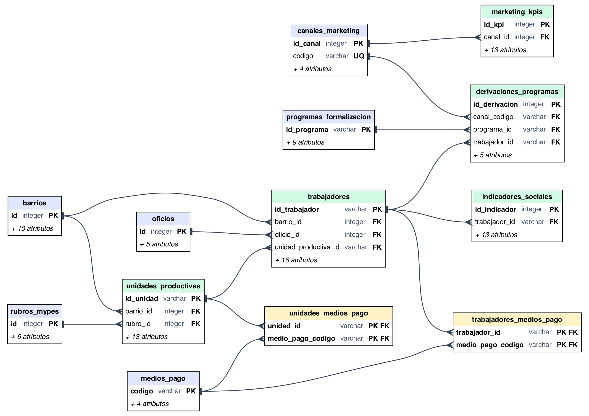

# UNIVERSIDAD NACIONAL DE VILLARRICA DEL ESPÍRITU SANTO
## FACULTAD DE CIENCIAS ECONÓMICAS
### CARRERA DE LICENCIATURA EN ADMINISTRACIÓN DE EMPRESAS — SEDE CENTRAL VILLARRICA
**Proyecto Interdisciplinario 8.° Semestre — Año Lectivo 2026**

---

# CAPÍTULO DE CÁTEDRA: SISTEMA DE INFORMACIÓN GERENCIAL (SIG)
## Documentación Técnica Integral, Arquitectura de Datos, Modelado Relacional 3FN y Manuales de Operación

**Proyecto:** Transformación Digital y Diagnóstico Social en la Gestión Organizacional: La Informalidad Laboral en el Paraguay  
**Materia:** Sistema de Información Gerencial (SIG)  
**Materias Intervinientes:** Análisis de la Realidad Social del Paraguay | Marketing Social  
**Docente Responsable:** Prof. Mag. Clara Demattei  
**Mesa Evaluadora Interdisciplinaria:** Prof. Mag. Clara Demattei, Prof. Mag. Gerardo Ortiz, Prof. Dra. Ramona Demattei  
**Equipo Técnico Responsable:** Estudiantes del 8.° Semestre de la Carrera de Administración de Empresas  
**Fecha de Presentación:** Octubre / Noviembre de 2026  
**Villarrica, Departamento del Guairá, República del Paraguay**

---

## 1. INTRODUCCIÓN Y JUSTIFICACIÓN TECNOLÓGICA DEL SIG

En el marco de la gestión organizacional contemporánea, las decisiones estratégicas no pueden fundamentarse en intuiciones o estimaciones empíricas desprovistas de respaldo cuantitativo. La informalidad laboral en el distrito de Villarrica representa un fenómeno socioeconómico estructural complejo, caracterizado por la heterogeneidad de ingresos, la vulnerabilidad previsional y la dispersión territorial de las actividades no registradas. 

Frente a este desafío, la Cátedra de **Sistema de Información Gerencial (SIG)** diseñó e implementó una infraestructura digital de captura, almacenamiento normalizado, procesamiento analítico y visualización en tiempo real. Este sistema resuelve la desconexión tradicional entre el relevamiento de campo social y la ejecución de campañas de marketing social, proporcionando una plataforma unificada para la gobernanza de datos y la formulación de políticas públicas de formalización laboral.

### 1.1 Objetivos del Sistema de Información Gerencial
1. **Captura Digital Confiable:** Digitalizar integralmente el censo social y empresarial en terreno mediante dispositivos móviles inteligentes utilizando la suite Open Data Kit (ODK) y KoboToolbox, eliminando el error de transcripción y garantizando georreferenciación milimétrica por GPS.
2. **Normalización y Persistencia Robusta:** Almacenar la información en un motor relacional empresarial **PostgreSQL 16**, estructurado rigurosamente en **Tercera Forma Normal (3FN)** con claves foráneas, restricciones de dominio, checks de consistencia e índices optimizados.
3. **Interoperabilidad Interdisciplinaria:** Sincronizar automáticamente los 10 indicadores de la Cátedra de *Análisis de la Realidad Social del Paraguay* y las métricas de rendimiento multicanal de la Cátedra de *Marketing Social*.
4. **Soporte para la Toma de Decisiones (BI):** Proveer un **Dashboard Gerencial Interactivo** y vistas analíticas optimizadas compatibles con suites de Inteligencia de Negocios (Power BI, Tableau, R Shiny), facilitando la visualización espacial de clústeres de informalidad y el cálculo de la eficiencia de conversión hacia programas oficiales como RESIMPLE, IPS y SUACE.

---

## 2. ARQUITECTURA TECNOLÓGICA INTEGRAL DEL SISTEMA

La solución arquitectónica implementada adopta un enfoque modular desacoplado en capas, basado en estándares abiertos, alta resiliencia y reproducibilidad científica:

```
+----------------------------------------------------------------------------------------------------+
|                                    ARQUITECTURA INTEGRAL DEL SIG                                   |
+----------------------------------------------------------------------------------------------------+
| 1. CAPA DE CAPTURA DIGITAL (MÓVIL / CAMPO)                                                        |
|    - ODK Collect / KoboCollect en smartphones Android (offline con geocaché)                      |
|    - Censo a 420 trabajadores informales y 135 unidades productivas (7 barrios de Villarrica)      |
|    - Formulario XLSForm (constraints de validación, geocercas [-25.80, -25.70; -56.50, -56.40])    |
+----------------------------------------------------------------------------------------------------+
                                                 | (Sincronización HTTPS JSON/REST)
                                                 v
+----------------------------------------------------------------------------------------------------+
| 2. CAPA DE EXTRACCIÓN, TRANSFORMACIÓN Y CARGA (ETL EN PYTHON 3.11+)                                |
|    - Ingesta y validación tipada estricta (Pydantic / dataclasses)                                |
|    - Reglas de negocio: Cálculo de brecha salarial vs. Gs. 3.044.000, clasificación de jornada,   |
|      índice de vulnerabilidad social compuesto (0-100 pts) y normalización 1FN/2FN/3FN            |
|    - Carga transaccional atómica e idempotente (scripts/process_trabajadores.py, db/load_data.py)  |
+----------------------------------------------------------------------------------------------------+
                                                 | (Transacciones ACID / SQL)
                                                 v
+----------------------------------------------------------------------------------------------------+
| 3. CAPA DE PERSISTENCIA Y MODELADO RELACIONAL (POSTGRESQL 16)                                      |
|    - Esquema relacional en 3FN con 6 catálogos, 5 tablas maestras/transaccionales y 2 tablas N:M  |
|    - Índices B-Tree en FKs y compuestos geoespaciales (latitud, longitud)                         |
|    - 4 Vistas Analíticas Materializadas/Consolidadas (vw_trabajadores, vw_unidades, etc.)         |
+----------------------------------------------------------------------------------------------------+
                        |                                                |
                        v (Extracción SQL / Datasets CSV)                v (JSON / JS API)
+----------------------------------------------+ +---------------------------------------------------+
| 4. BACKEND ANALÍTICO Y ECONOMÉTRICO (R / PY) | | 5. VISUALIZACIÓN Y BUSINESS INTELLIGENCE          |
|    - Scripts R: Regresión de Mincer, ANOVA,   | |    - Dashboard Gerencial Web Interactivo         |
|      Kruskal-Wallis, Welch t-test, correlación| |      (docs/dashboard.html, Leaflet, Chart.js)    |
|    - Generación de gráficos APA 7 vectoriales | |    - Conectores directos para Power BI / Tableau |
|      (output/figura1 a figura5 en PNG y SVG)  | |    - Filtros dinámicos multidimensionales        |
+----------------------------------------------+ +---------------------------------------------------+
```

### 2.1 Especificaciones de Cada Capa Tecnológica

1. **Capa de Captura Móvil:**
   - **Herramienta:** KoboToolbox / ODK Collect v2024.1+.
   - **Mecanismo:** Captura autónoma fuera de línea (*offline-first*). Los encuestadores registran datos y puntos GPS en barrios periféricos sin señal móvil; los datos se encriptan localmente en SQLite y se sincronizan vía HTTPS al detectar conexión institucional UNVES.
   - **Control de Calidad:** Reglas de validación programadas en XLSForm que bloquean edades fuera de rango (18 a 85 años), salarios inferiores a Gs. 300.000 o superiores a Gs. 15.000.000, e inconsistencias como declarar aporte a IPS sin tener número patronal.

2. **Capa de Procesamiento y Pipeline ETL (Python):**
   - **Lenguaje:** Python 3.11 / 3.12.
   - **Módulos:** `psycopg2` (driver de base de datos de alta velocidad con cursores de diccionario), `pydantic` (validación de esquemas y tipos), `numpy` y `pandas` (procesamiento tabular y vectorización).
   - **Idempotencia:** Cada carga utiliza claves subrogadas y UUIDs universales para evitar duplicaciones si el pipeline se ejecuta de manera redundante.

3. **Capa de Persistencia (PostgreSQL 16):**
   - **Motor:** PostgreSQL versión 16.x configurado con codificación `UTF-8` y timezone `America/Asuncion`.
   - **Integridad:** Cumplimiento estricto del estándar ACID (Atomicidad, Consistencia, Aislamiento y Durabilidad). Integridad referencial mediante restricciones `ON UPDATE CASCADE` y `ON DELETE RESTRICT` / `ON DELETE CASCADE`.

4. **Capa Analítica y de Visualización:**
   - **R Analysis:** Entorno R v4.3+ con librerías `ggplot2`, `dplyr`, `readr`, `broom` para el modelado econométrico conforme a normas APA 7.ª edición.
   - **Dashboard Web:** Aplicación de inteligencia de negocios basada en HTML5, CSS3 con diseño *responsive* glassmórfico de alto estándar, mapas interactivos con **Leaflet 1.9.4** (OpenStreetMap) y componentes gráficos analíticos mediante **Chart.js 4.4.1**.

---

## 3. MODELADO ENTIDAD-RELACIÓN Y DICCIONARIO DE DATOS EN 3FN

### 3.1 Fundamentación del Modelado en Tercera Forma Normal (3FN)

El diseño conceptual y lógico del sistema fue sometido a un riguroso proceso de normalización relacional:
1. **Primera Forma Normal (1FN):** Se eliminaron los atributos multivaluados y los grupos repetitivos. Por ejemplo, la multiplicidad de medios de pago que un trabajador o una MYPE acepta (efectivo, Tigo Money, QR, SIPAP) fue desagregada en entidades asociativas intermedias (`trabajadores_medios_pago` y `unidades_medios_pago`), garantizando que cada celda contenga un valor atómico.
2. **Segunda Forma Normal (2FN):** Toda tabla con clave primaria compuesta posee dependencias funcionales completas; ningún atributo no clave depende de un subconjunto de la clave primaria.
3. **Tercera Forma Normal (3FN):** Se eliminaron las dependencias transitivas. Los datos de catálogos (barrios, oficios, rubros económicos, canales de difusión y programas estatales) se separaron en tablas de dimensiones con identificadores únicos, evitando que la modificación de un atributo dimensional (como la cuota fija o la base legal de RESIMPLE) requiera actualizar cientos de registros de trabajadores o unidades productivas.

### 3.2 Diagrama Entidad-Relación (DER)
El diagrama entidad-relación se generó directamente desde el catálogo de PostgreSQL (`scripts/generate_er_diagram.py`), por lo que refleja exactamente las 13 tablas y las 14 claves foráneas implementadas. Se dispone además de una versión interactiva:
- **Diagrama imprimible (PNG):** [diagrama_er_impresion.png](img/diagrama_er_impresion.png)
- **Diagrama vectorial (SVG):** [diagrama_er.svg](diagrama_er.svg)
- **Visualizador web interactivo:** [diagrama_er.html](diagrama_er.html)



*Nota.* PK = clave primaria; FK = clave foránea; UQ = clave única. Azul: catálogos; verde: tablas maestras y transaccionales; amarillo: tablas asociativas N:M. Relaciones principales: `barrios` 1:N `trabajadores` y `unidades_productivas`; `trabajadores` 1:1 `indicadores_sociales`; `unidades_productivas` 1:N `trabajadores`; `canales_marketing` 1:N `marketing_kpis` y `derivaciones_programas`; `programas_formalizacion` 1:N `derivaciones_programas`; `trabajadores` 1:N `derivaciones_programas`; `medios_pago` N:M `trabajadores` y `unidades_productivas`.

---

### 3.3 Diccionario de Datos Exhaustivo

#### 3.3.1 Tablas de Catálogo y Dimensiones

##### A. Tabla `barrios` (Catálogo Territorial)
Registra la delimitación geográfica, coordenadas y pesos poblacionales de los barrios censados en el municipio de Villarrica.

| Campo | Tipo PostgreSQL | Restricción | Clave | Descripción |
| :--- | :--- | :--- | :--- | :--- |
| `id` | `SERIAL` | `NOT NULL` | **PK** | Identificador único secuencial del barrio. |
| `nombre` | `VARCHAR(80)` | `NOT NULL, UNIQUE` | | Nombre oficial del barrio (Centro, Ybaroty, San Miguel, etc.). |
| `lat_min` | `NUMERIC(10, 6)` | `NOT NULL` | | Límite sur de latitud para geocercado del barrio. |
| `lat_max` | `NUMERIC(10, 6)` | `NOT NULL` | | Límite norte de latitud para geocercado del barrio. |
| `lon_min` | `NUMERIC(10, 6)` | `NOT NULL` | | Límite oeste de longitud para geocercado del barrio. |
| `lon_max` | `NUMERIC(10, 6)` | `NOT NULL` | | Límite este de longitud para geocercado del barrio. |
| `alt_min` | `NUMERIC(6, 2)` | `NOT NULL` | | Altitud mínima sobre el nivel del mar (metros). |
| `alt_max` | `NUMERIC(6, 2)` | `NOT NULL` | | Altitud máxima sobre el nivel del mar (metros). |
| `peso_muestral` | `NUMERIC(4, 2)` | `CHECK (> 0 AND <= 1.0)` | | Ponderador de representatividad demográfica barrial. |
| `descripcion` | `TEXT` | `NOT NULL` | | Reseña socioeconómica y perfil comercial del barrio. |
| `creado_en` | `TIMESTAMPTZ` | `DEFAULT CURRENT_TIMESTAMP` | | Fecha y hora de inserción en el sistema. |

##### B. Tabla `oficios` (Catálogo de Ocupaciones Informales)
Catálogo normalizado de ocupaciones del sector informal individual en Villarrica.

| Campo | Tipo PostgreSQL | Restricción | Clave | Descripción |
| :--- | :--- | :--- | :--- | :--- |
| `id` | `SERIAL` | `NOT NULL` | **PK** | Identificador numérico del oficio. |
| `nombre` | `VARCHAR(120)` | `NOT NULL, UNIQUE` | | Denominación del oficio (Albañil, Vendedor, Modista, etc.). |
| `sector` | `VARCHAR(60)` | `NOT NULL` | | Sector de actividad económica (Construcción, Textil, etc.). |
| `ingreso_base_pyg` | `NUMERIC(12, 2)` | `CHECK (>= 0)` | | Ingreso medio de referencia para calibración de campo. |
| `descripcion` | `TEXT` | | | Alcance de las tareas desempeñadas en la ocupación. |
| `creado_en` | `TIMESTAMPTZ` | `DEFAULT CURRENT_TIMESTAMP` | | Auditoría de creación. |

##### C. Tabla `rubros_mypes` (Catálogo de Sectores Productivos)
Clasificación de unidades productivas informales y microempresas relevadas.

| Campo | Tipo PostgreSQL | Restricción | Clave | Descripción |
| :--- | :--- | :--- | :--- | :--- |
| `id` | `SERIAL` | `NOT NULL` | **PK** | Identificador del rubro económico. |
| `nombre` | `VARCHAR(120)` | `NOT NULL, UNIQUE` | | Denominación del rubro (Gastronomía, Talleres, Despensas). |
| `sector_economico`| `VARCHAR(60)` | `NOT NULL` | | Sector macro (Comercio, Manufactura, Servicios). |
| `facturacion_base_pyg`| `NUMERIC(14, 2)`| `CHECK (>= 0)` | | Facturación mensual de referencia para el estrato MYPE. |
| `rango_trabajadores_min`| `INT` | `CHECK (>= 1)` | | Dotación mínima observada de trabajadores. |
| `rango_trabajadores_max`| `INT` | `CHECK (>= min)` | | Dotación máxima observada de trabajadores. |
| `creado_en` | `TIMESTAMPTZ` | `DEFAULT CURRENT_TIMESTAMP` | | Auditoría de registro. |

##### D. Tabla `medios_pago` (Inclusión Financiera y Medios de Cobro)
Catálogo de instrumentos de pago habilitados o aceptados por trabajadores y establecimientos.

| Campo | Tipo PostgreSQL | Restricción | Clave | Descripción |
| :--- | :--- | :--- | :--- | :--- |
| `codigo` | `VARCHAR(30)` | `NOT NULL` | **PK** | Código alfanumérico (`efectivo`, `tigo_money`, `qr_bancario`). |
| `nombre` | `VARCHAR(80)` | `NOT NULL, UNIQUE` | | Nombre formal del medio de pago. |
| `categoria` | `VARCHAR(50)` | `NOT NULL` | | Categoría (Efectivo, Billetera Móvil, Banca Digital). |
| `es_digital` | `BOOLEAN` | `DEFAULT FALSE` | | Flag indicador de canal electrónico/digital. |
| `descripcion` | `TEXT` | | | Resumen del funcionamiento y proveedor del servicio. |

##### E. Tabla `canales_marketing` (Estrategia de Comunicación)
Canales tácticos desplegados en la campaña de marketing social *"Trabajo Formal, Futuro Seguro"*.

| Campo | Tipo PostgreSQL | Restricción | Clave | Descripción |
| :--- | :--- | :--- | :--- | :--- |
| `id_canal` | `SERIAL` | `NOT NULL` | **PK** | Identificador secuencial del canal. |
| `codigo` | `VARCHAR(30)` | `NOT NULL, UNIQUE` | | Nemotécnico (`META_ADS`, `WHATSAPP`, `PUNTOS_PRESENCIALES`, `AFICHES_QR`). |
| `nombre` | `VARCHAR(100)` | `NOT NULL, UNIQUE` | | Nombre descriptivo del canal de marketing. |
| `tipo` | `VARCHAR(50)` | `NOT NULL` | | Tipología (Digital Pago, Digital Mensajería, BTL, OOH). |
| `responsable_operativo`| `VARCHAR(100)`| `NOT NULL` | | Equipo o brigada de cátedra asignada. |
| `descripcion` | `TEXT` | | | Táctica de difusión, target y formato utilizado. |

##### F. Tabla `programas_formalizacion` (Programas Estatales de Articulación)
Programas institucionales de formalización hacia los cuales se derivan consultas ciudadanas.

| Campo | Tipo PostgreSQL | Restricción | Clave | Descripción |
| :--- | :--- | :--- | :--- | :--- |
| `id_programa` | `VARCHAR(20)` | `NOT NULL` | **PK** | Identificador del programa (`RESIMPLE`, `IPS_MICRO`, `SUACE`). |
| `nombre` | `VARCHAR(150)`| `NOT NULL, UNIQUE` | | Nombre oficial completo del programa institucional. |
| `institucion_rectora`| `VARCHAR(120)`| `NOT NULL` | | Organismo público responsable (DNIT, IPS, MIC). |
| `tipo_beneficio` | `VARCHAR(100)`| `NOT NULL` | | Beneficio principal (Monotributo, Seguro de Salud, etc.). |
| `base_legal` | `VARCHAR(150)`| `NOT NULL` | | Marco jurídico y leyes habilitantes (Ley 6380/19, etc.). |
| `contacto_villarrica`| `VARCHAR(150)`| `NOT NULL` | | Ubicación física y teléfonos de atención en Villarrica. |
| `requisitos_resumen`| `TEXT` | `NOT NULL` | | Requisitos documentales básicos para postular. |
| `descripcion` | `TEXT` | `NOT NULL` | | Alcance programático y población objetivo. |
| `activo` | `BOOLEAN` | `DEFAULT TRUE` | | Estado de vigencia operativa del programa. |
| `creado_en` | `TIMESTAMPTZ` | `DEFAULT CURRENT_TIMESTAMP` | | Fecha de alta en el sistema. |

---

#### 3.3.2 Tablas Maestras y Transaccionales

##### G. Tabla `trabajadores` (Diagnóstico Sociodemográfico Individual)
Almacena el censo individual de 420 trabajadores informales de Villarrica relevados mediante ODK.

| Campo | Tipo PostgreSQL | Restricción | Clave | Descripción |
| :--- | :--- | :--- | :--- | :--- |
| `id_trabajador` | `VARCHAR(20)` | `NOT NULL` | **PK** | Código alfanumérico institucional (`TRAB-0001` a `TRAB-0420`). |
| `kobo_uuid` | `UUID` | `NOT NULL, UNIQUE` | | Identificador universal único del envío ODK/KoboToolbox. |
| `fecha_recoleccion`| `DATE` | `NOT NULL` | | Fecha en que se aplicó la entrevista en terreno. |
| `barrio_id` | `INT` | `NOT NULL` | **FK** | Referencia a `barrios.id` (ON UPDATE CASCADE RESTRICT). |
| `latitud` | `NUMERIC(10, 6)`| `CHECK (BETWEEN -25.80 Y -25.70)`| | Coordenada GPS latitud capturada por el móvil. |
| `longitud` | `NUMERIC(10, 6)`| `CHECK (BETWEEN -56.50 Y -56.40)`| | Coordenada GPS longitud capturada por el móvil. |
| `edad` | `INT` | `CHECK (BETWEEN 15 Y 99)` | | Edad biológica en años cumplidos del trabajador. |
| `genero` | `VARCHAR(20)` | `CHECK IN ('masculino','femenino','otro')`| | Identidad de género del entrevistado. |
| `oficio_id` | `INT` | `NOT NULL` | **FK** | Referencia a `oficios.id` (ON UPDATE CASCADE RESTRICT). |
| `antiguedad_oficio_anios`| `INT` | `CHECK (>= 0)` | | Años de experiencia en la labor actual. |
| `ingreso_mensual_pyg`| `NUMERIC(12, 2)`| `CHECK (>= 0)` | | Ingreso promedio mensual declarado en Guaraníes. |
| `horas_semanales`| `INT` | `CHECK (BETWEEN 1 Y 120)` | | Carga horaria habitual semanal trabajada. |
| `cobertura_ips` | `VARCHAR(50)` | `NOT NULL` | | Situación previsional (e.g., "Sin seguro IPS", "Con seguro IPS"). |
| `motivo_no_ips` | `VARCHAR(100)`| `NOT NULL` | | Razón del no aporte (Costo excesivo, Atención hospitalaria, etc.). |
| `posee_smartphone`| `VARCHAR(5)` | `CHECK IN ('si', 'no')` | | Tenencia de teléfono móvil inteligente. |
| `tipo_conectividad`| `VARCHAR(50)`| `NOT NULL` | | Acceso a internet (WiFi domiciliario, Paquetes diarios, etc.).|
| `conoce_resimple`| `VARCHAR(5)` | `CHECK IN ('si', 'no')` | | Conocimiento previo del régimen simplificado DNIT. |
| `interes_formalizacion`| `VARCHAR(50)`| `NOT NULL` | | Disposición a formalizarse o capacitarse. |
| `unidad_productiva_id`| `VARCHAR(20)`| | **FK** | Referencia a `unidades_productivas.id_unidad` (MYPE empleadora). |
| `creado_en` | `TIMESTAMPTZ` | `DEFAULT CURRENT_TIMESTAMP` | | Marca temporal de auditoría en base de datos. |

##### H. Tabla `indicadores_sociales` (10 Métricas Analíticas de Realidad Social)
Normalizada en relación 1:1 con `trabajadores` para aislar las variables analíticas calculadas.

| Campo | Tipo PostgreSQL | Restricción | Clave | Descripción |
| :--- | :--- | :--- | :--- | :--- |
| `id_indicador` | `SERIAL` | `NOT NULL` | **PK** | Clave primaria autoincremental de la métrica social. |
| `trabajador_id` | `VARCHAR(20)` | `NOT NULL, UNIQUE` | **FK** | Referencia a `trabajadores.id_trabajador` (CASCADE). |
| `salario_minimo_referencia_pyg`| `NUMERIC(12, 2)`| `DEFAULT 3044000.00` | | Salario mínimo legal vigente de referencia (Julio 2026). |
| `brecha_salario_pyg`| `NUMERIC(12, 2)`| `NOT NULL` | | Diferencial (`ingreso_mensual_pyg - salario_minimo`). |
| `situacion_respecto_minimo`| `VARCHAR(50)`| `CHECK IN ('Inferior al mínimo', ...)`| | Clasificación categórica de solvencia mínima. |
| `condicion_jornada`| `VARCHAR(60)`| `CHECK IN ('Subocupado...', 'Sobreocupado...')`| | Condición de jornada según marco OIT/INE. |
| `nivel_educativo`| `VARCHAR(80)` | `NOT NULL` | | Grado educativo máximo (Primaria, Secundaria, Superior). |
| `anios_estudio` | `INT` | `CHECK (BETWEEN 0 Y 30)` | | Años acumulados de escolaridad formal. |
| `brecha_digital`| `VARCHAR(80)` | `NOT NULL` | | Diagnóstico de exclusión/inclusión en tecnología digital. |
| `acepta_pagos_digitales`| `VARCHAR(5)`| `CHECK IN ('si', 'no')` | | Habilitación de cobros con billeteras o QR. |
| `personas_a_cargo`| `INT` | `CHECK (>= 0)` | | Carga familiar económica en el hogar. |
| `tenencia_vivienda`| `VARCHAR(50)`| `CHECK IN ('propia', 'alquilada', ...)`| | Condición de propiedad del inmueble donde reside. |
| `indice_vulnerabilidad_social`| `NUMERIC(5, 2)`| `CHECK (BETWEEN 0 Y 100)` | | Puntuación compuesta ponderada de vulnerabilidad (0-100). |
| `clasificacion_vulnerabilidad`| `VARCHAR(40)`| `CHECK IN ('Vulnerabilidad Baja', ...)`| | Estratificación cualitativa (Baja, Media, Alta, Crítica). |
| `fecha_calculo` | `TIMESTAMPTZ` | `DEFAULT CURRENT_TIMESTAMP` | | Fecha de cálculo automatizado de indicadores. |

##### I. Tabla `unidades_productivas` (Censo de MYPEs y Establecimientos)
Registra las 135 unidades económicas informales y talleres censados en Villarrica.

| Campo | Tipo PostgreSQL | Restricción | Clave | Descripción |
| :--- | :--- | :--- | :--- | :--- |
| `id_unidad` | `VARCHAR(20)` | `NOT NULL` | **PK** | Código único de la unidad (`MYPE-VIL-001` a `135`). |
| `nombre_establecimiento`| `VARCHAR(150)`| `NOT NULL` | | Nombre o razón de fantasía del taller/comercio. |
| `barrio_id` | `INT` | `NOT NULL` | **FK** | Referencia a `barrios.id`. |
| `latitud` | `NUMERIC(10, 6)`| `CHECK (BETWEEN -25.80 Y -25.70)`| | Coordenada GPS latitud del establecimiento. |
| `longitud` | `NUMERIC(10, 6)`| `CHECK (BETWEEN -56.50 Y -56.40)`| | Coordenada GPS longitud del establecimiento. |
| `rubro_id` | `INT` | `NOT NULL` | **FK** | Referencia a `rubros_mypes.id`. |
| `antiguedad_anios`| `INT` | `CHECK (>= 0)` | | Años de operación continua del negocio en el barrio. |
| `total_trabajadores`| `INT` | `CHECK (>= 1)` | | Plantel total de operarios y dependientes. |
| `trabajadores_sin_ips`| `INT` | `CHECK (>= 0)` | | Cantidad de trabajadores dependientes sin seguro IPS. |
| `trabajadores_con_ips`| `INT` | `CHECK (>= 0)` | | Cantidad de trabajadores formalmente asegurados. |
| `tasa_informalidad_laboral_pct`| `NUMERIC(5, 2)`| `CHECK (BETWEEN 0 Y 100)` | | `(trabajadores_sin_ips / total_trabajadores) * 100`. |
| `estado_tributario_ruc`| `VARCHAR(80)`| `NOT NULL` | | Condición tributaria (Sin RUC, Inscripto en RESIMPLE). |
| `motivo_no_aporte_ips`| `TEXT` | `NOT NULL` | | Justificación patronal del no aseguramiento del personal. |
| `ingreso_mensual_estimado_pyg`| `NUMERIC(14, 2)`| `CHECK (>= 0)` | | Facturación bruta mensual estimada en Guaraníes. |
| `disposicion_formalizar`| `VARCHAR(80)`| `NOT NULL` | | Apertura patronal a sumarse a ventanilla SUACE/RESIMPLE. |
| `creado_en` | `TIMESTAMPTZ` | `DEFAULT CURRENT_TIMESTAMP` | | Auditoría del registro. |

##### J. Tabla `marketing_kpis` (Métricas Diarias de Campaña)
Monitorea la serie de tiempo diaria (42 días de campaña) de los 4 canales de marketing social.

| Campo | Tipo PostgreSQL | Restricción | Clave | Descripción |
| :--- | :--- | :--- | :--- | :--- |
| `id_kpi` | `SERIAL` | `NOT NULL` | **PK** | Clave primaria de la métrica diaria. |
| `fecha` | `DATE` | `NOT NULL` | | Fecha de la medición (del 01/09/2026 al 12/10/2026). |
| `canal_id` | `INT` | `NOT NULL` | **FK** | Referencia a `canales_marketing.id_canal`. |
| `impresiones_alcance`| `INT` | `CHECK (>= 0)` | | Personas alcanzadas o impresiones servidas en el día. |
| `clics_interacciones`| `INT` | `CHECK (>= 0)` | | Clics, interacciones o personas atendidas en stand. |
| `ctr_interaccion_pct`| `NUMERIC(6, 2)`| `CHECK (>= 0)` | | Ratio `(interacciones / impresiones) * 100`. |
| `consultas_iniciadas`| `INT` | `CHECK (>= 0)` | | Solicitudes de información sobre formalización. |
| `consultas_tema_resimple`| `INT` | `CHECK (>= 0)` | | Consultas orientadas específicamente al monotributo. |
| `consultas_tema_ips`| `INT` | `CHECK (>= 0)` | | Consultas relativas a la seguridad social médica/jubilatoria.|
| `derivaciones_suace_villarrica`| `INT`| `CHECK (>= 0)` | | Ciudadanos agendados o guiados a ventanilla SUACE. |
| `derivaciones_ips_regional`| `INT`| `CHECK (>= 0)` | | Ciudadanos derivados a la oficina regional IPS. |
| `derivaciones_totales_formalizacion`| `INT`| `CHECK (>= 0)` | | Suma exacta de derivaciones SUACE + IPS. |
| `presupuesto_invertido_pyg`| `NUMERIC(12, 2)`| `CHECK (>= 0)` | | Costo operativo diario asignado al canal en PYG. |
| `costo_por_consulta_pyg`| `NUMERIC(12, 2)`| `CHECK (>= 0)` | | `presupuesto / consultas_iniciadas`. |
| `creado_en` | `TIMESTAMPTZ` | `DEFAULT CURRENT_TIMESTAMP` | | Auditoría del registro. |

##### K. Tabla `derivaciones_programas` (Trazabilidad y Articulación Interinstitucional)
Registra nominal y trazablemente cada una de las 2.217 derivaciones efectivas generadas por los 4 canales de marketing social hacia las ventanillas de SUACE e IPS Regional Villarrica, vinculadas individualmente a trabajadores y programas.

| Campo | Tipo PostgreSQL | Restricción | Clave | Descripción |
| :--- | :--- | :--- | :--- | :--- |
| `id_derivacion` | `INT` | `NOT NULL` | **PK** | Identificador secuencial único de la derivación (1 a 2.217). |
| `codigo_derivacion` | `VARCHAR(40)` | `NOT NULL, UNIQUE` | | Código de expediente (`DER-2026-SUACE-0001` o `DER-2026-IPS-0001`). |
| `fecha_derivacion` | `DATE` | `NOT NULL` | | Fecha efectiva de derivación (01/09/2026 al 12/10/2026). |
| `canal_codigo` | `VARCHAR(30)` | `NOT NULL` | **FK** | Referencia al canal emisor en `canales_marketing.codigo`. |
| `programa_id` | `VARCHAR(20)` | `NOT NULL` | **FK** | Referencia al programa de destino (`SUACE` o `IPS_MICRO`). |
| `trabajador_id` | `VARCHAR(20)` | | **FK** | Referencia al trabajador derivado en `trabajadores.id_trabajador`. |
| `estado_tramite` | `VARCHAR(50)` | `NOT NULL` | | Estado actual: 'Formalizado', 'En Asistencia', 'Derivado Efectivo'. |
| `atendido_por` | `VARCHAR(120)` | `NOT NULL` | | Ventanilla u oficina receptora en Villarrica. |
| `creado_en` | `TIMESTAMPTZ` | `DEFAULT CURRENT_TIMESTAMP` | | Marca temporal de auditoría del trámite. |

---

#### 3.3.3 Tablas Asociativas N:M

- **`trabajadores_medios_pago`**: Vincula a los 420 trabajadores con los medios de pago que utilizan habitualmente (1.082 relaciones registradas). Clave primaria compuesta `(trabajador_id, medio_pago_codigo)`.
- **`unidades_medios_pago`**: Asocia a las 135 unidades productivas con los métodos de cobro aceptados en su local (319 relaciones registradas). Clave primaria compuesta `(unidad_id, medio_pago_codigo)`.

---

#### 3.3.4 Vistas Analíticas Gerenciales (Business Intelligence)

1. **`vw_trabajadores_consolidado` (420 filas):**
   - **Propósito:** Desnormaliza en tiempo de consulta la información sociodemográfica del trabajador con los 10 indicadores sociales calculados, el nombre del barrio, el oficio y la lista agregada de medios de pago en texto separado por comas (`STRING_AGG`).
   - **Uso:** Alimenta directamente la Pestaña 1 del Dashboard Web y el pipeline econométrico en R.

2. **`vw_unidades_productivas_consolidado` (135 filas):**
   - **Propósito:** Integra la caracterización de cada MYPE con el nombre del rubro, el sector macro, la tasa de informalidad patronal y los medios de cobro aceptados.
   - **Uso:** Alimenta la Pestaña 2 del Dashboard y los análisis de informalidad por sector económico.

3. **`vw_marketing_resumen_canales` (4 filas):**
   - **Propósito:** Agrupa y consolida los 168 registros de la serie de tiempo diaria para computar el alcance total (193.889), interacciones (23.869), CTR medio, total de consultas (8.792), derivaciones efectivas (2.217) y costos unitarios (CAC y costo por derivación).
   - **Uso:** Sustenta la Pestaña 3 del Dashboard y el análisis de retorno de inversión social (SROI).

4. **`vw_articulacion_programas_formalizacion` (3 filas):**
   - **Propósito:** Consolida el flujo de demanda canalizada desde la campaña de marketing social hacia cada programa estatal (RESIMPLE, IPS_MICRO, SUACE), contrastándolo con el número de MYPEs relevadas que ya están adheridas a cada régimen.
   - **Uso:** Permite medir la brecha entre la demanda ciudadana asistida y la cobertura institucional local.

---

## 4. MANUAL TÉCNICO DE INSTALACIÓN Y OPERACIÓN DEL SIG

### 4.1 Requisitos del Sistema e Infraestructura

- **Hardware Recomendado:**
  - Procesador: Arquitectura x86_64 o ARM64 (Apple Silicon / Intel Core i5 o superior).
  - Memoria RAM: Mínimo 8 GB (16 GB recomendado para renderizado geoespacial).
  - Espacio en Disco: 2 GB de espacio libre para binarios, datasets y base de datos.
- **Software Base y Dependencias:**
  - Sistema Operativo: Linux (Ubuntu 22.04+ / Debian 12), macOS Sonoma/Sequoia o Windows 11 con WSL2.
  - Servidor de Base de Datos: **PostgreSQL 14, 15 o 16**.
  - Intérprete de Lenguaje: **Python 3.10+** (probado y validado en Python 3.11 y 3.12).
  - Entorno Estadístico: **R versión 4.2+** (para ejecución de tests paramétricos y econométricos).
  - Librerías Python (`requirements.txt`):
    ```
    psycopg2-binary>=2.9.9
    pydantic>=2.5.0
    numpy>=1.26.0
    pandas>=2.1.0
    ```

### 4.2 Despliegue de la Base de Datos y Creación del Esquema

1. **Configuración de Variables de Entorno:**
   Definir los parámetros de conexión en el entorno local o en un archivo `.env`:
   ```bash
   export PGHOST="localhost"
   export PGPORT="5432"
   export PGDATABASE="unves_sig_2026"
   export PGUSER="usuario_postgres"
   export PGPASSWORD="password_seguro"
   ```

2. **Creación de la Base de Datos en PostgreSQL:**
   ```bash
   createdb -h $PGHOST -p $PGPORT -U $PGUSER unves_sig_2026
   ```

3. **Ejecución del Script DDL Normalizado en 3FN:**
   ```bash
   psql -h $PGHOST -p $PGPORT -U $PGUSER -d unves_sig_2026 -f db/schema.sql
   ```
   *El script creará las extensiones `uuid-ossp` y `pgcrypto`, las 13 tablas con sus restricciones y claves foráneas, los índices B-Tree y espaciales, y las 4 vistas analíticas.*

---

### 4.3 Procedimiento de Captura Móvil en Campo (KoboCollect / ODK)

1. **Carga del Formulario en el Servidor KoboToolbox:**
   - Acceder al servidor institucional de KoboToolbox (`kf.kobotoolbox.org` o instancia local).
   - Importar la especificación XLSForm definida en `kobo/form_specification.md` y `kobo/survey_schema.json` con Form ID: `encuesta_informalidad_villarrica_2026`.
   - Publicar el formulario y generar el código QR de configuración rápida.

2. **Configuración de los Dispositivos Móviles de los Estudiantes:**
   - Instalar la aplicación gratuita **ODK Collect** o **KoboCollect** desde Google Play Store en los teléfonos inteligentes de las brigadas estudiantiles.
   - En la aplicación, seleccionar *Configurar mediante código QR* y escanear el código institucional.
   - Habilitar el módulo de geolocalización GPS en modo de *Alta Precisión*.
   - Descargar el formulario en blanco `encuesta_informalidad_villarrica_2026`.

3. **Protocolo Operativo de Levantamiento en los Barrios de Villarrica:**
   - Los encuestadores se despliegan en parejas en los 7 barrios asignados (Centro, Ybaroty, San Miguel, Santa Librada, Estación, Lomas Valentinas, Tuyutimí).
   - Al abordar a un trabajador o propietario de taller, se lee y solicita el consentimiento informado.
   - La aplicación captura automáticamente: timestamp de inicio, coordenadas GPS de latitud y longitud (con umbral de precisión menor a 10 metros), y aplica saltos lógicos condicionales (por ejemplo, si declara no tener IPS, se despliega la lista obligatoria de motivos de exclusión).
   - Al finalizar, el formulario se guarda como *Finalizado*. No se requiere conexión a internet; la base SQLite local almacena las respuestas de forma cifrada.

4. **Sincronización y Descarga:**
   - Al finalizar la jornada y retornar a la Facultad de Ciencias Económicas (o al conectarse a redes WiFi seguras), la aplicación envía automáticamente los formularios completados al servidor central.
   - Se exporta el lote de datos en formato JSON/CSV para su ingesta por el pipeline ETL.

---

### 4.4 Ejecución del Pipeline ETL y Actualización de Vistas Analíticas

Para transformar los datos crudos de campo, computar los 10 indicadores sociales y persistir el censo en la base de datos PostgreSQL, se ejecuta el pipeline orquestador:

```bash
# 1. Ejecutar el pipeline completo de ingesta, cálculo y carga
python3 scripts/run_pipeline.py

# 2. Generar y exportar los datasets analíticos consolidados (CSV, JSON, JS)
python3 scripts/export_analytical_datasets.py

# 3. Validar la integridad referencial y consistencia de los datos
python3 scripts/verify_phase4.py
```

El script `run_pipeline.py` realiza las siguientes operaciones de forma atómica:
1. Lee las respuestas crudas de ODK/KoboToolbox.
2. Sanitiza tipos de datos, valida coordenadas geográficas dentro del radio de Villarrica y estandariza cadenas de texto en minúsculas y sin acentos conflictivos.
3. Calcula el **Índice de Vulnerabilidad Social** aplicando la función aditiva multidimensional de la cátedra de Realidad Social:
   $$\text{IVS} = \text{Dimensión Ingreso (0–35 pts)} + \text{Dimensión Educación (0–20 pts)} + \text{Carga Familiar (0–20 pts)} + \text{Tenencia Vivienda (0–15 pts)} + \text{Brecha Conectividad (0–10 pts)}$$
   donde:
   - *Ingreso relativo*: ratio ingreso / SML (Gs. 3.044.000) asigna 35 pts (<60%), 25 pts (<85%), 15 pts (<100%) o 5 pts ($\ge$100%).
   - *Educación acumulada*: $\le 4$ años (20 pts), $\le 6$ años (14 pts), $\le 9$ años (9 pts), $\le 12$ años (4 pts), $>12$ años (0 pts).
   - *Carga familiar*: $\min(\text{personas a cargo} \times 4, 20\text{ pts})$.
   - *Vivienda*: prestada/familiar (15 pts), alquilada (12 pts), propia (3 pts).
   - *Conectividad y smartphone*: sin smartphone (10 pts), con smartphone (2 pts).
   El índice resultante se clasifica en 4 estratos institucionales: Baja (<30 pts), Media (30–49.9 pts), Alta (50–69.9 pts) y Crítica ($\ge 70$ pts).
4. Ejecuta sentencias `INSERT ... ON CONFLICT DO UPDATE` en PostgreSQL para asegurar idempotencia estricta.
5. Exporta `docs/dashboard_data.json` y `docs/dashboard_data.js`, suministrando los datos consumidos de forma local y sin dependencias por el Dashboard Gerencial.

---

## 5. MANUAL DE USUARIO DEL DASHBOARD GERENCIAL INTERACTIVO

El **Dashboard Gerencial e Interactivo de Formalización Laboral de Villarrica** (`docs/dashboard.html`) es la herramienta ejecutiva diseñada para las autoridades de la FCE-UNVES, el Ministerio de Industria y Comercio, la DNIT y la Municipalidad de Villarrica. Permite explorar visualmente el diagnóstico social, la estructura productiva y la efectividad comunicacional.

### 5.1 Acceso y Requisitos de Navegación
- **Ubicación del Archivo:** [docs/dashboard.html](dashboard.html)
- **Navegadores Compatibles:** Google Chrome (v110+), Mozilla Firefox (v115+), Microsoft Edge (v110+), Safari (v16+).
- **Modo de Ejecución:** Autónomo (*standalone*). No requiere servidor web activo; puede abrirse directamente haciendo doble clic en el archivo HTML o navegando a la ruta `file://` en cualquier explorador moderno.

---

### 5.2 Estructura y Módulos de la Interfaz

```
+----------------------------------------------------------------------------------------------------+
| CABECERA INSTITUCIONAL: UNVES - FCE | Cátedras SIG, Realidad Social y Marketing Social             |
+----------------------------------------------------------------------------------------------------+
| BARRA DE FILTROS GLOBALES:                                                                         |
| [ Selector Barrio: Todos/7 ] [ Selector Género: Todos ] [ Selector Rubro ] [ Selector Canal ]     |
+----------------------------------------------------------------------------------------------------+
| TARJETAS DE KPIS GERENCIALES (KPI CARDS):                                                          |
| [ 420 Trabajadores ] [ Gs. 2.338.369 Media ] [ 85.2% < Mínimo ] [ 95.2% Sin IPS ] [ 2.217 Deriv. ] |
+----------------------------------------------------------------------------------------------------+
| PESTAÑAS NAVEGABLES:                                                                               |
| [ 1. Diagnóstico Social ] [ 2. Censo MYPEs ] [ 3. Marketing Social ] [ 4. Explorador de Datos ]    |
+----------------------------------------------------------------------------------------------------+
| ÁREA DE VISUALIZACIÓN DINÁMICA:                                                                    |
| - Mapa Cartográfico Interactivo Leaflet con marcadores de calor y clústeres barriales             |
| - Gráficos analíticos Chart.js (Brechas salariales, dispersión, embudo de conversión multicanal)   |
| - Explorador de microdatos con selector de vista y búsqueda por texto                              |
+----------------------------------------------------------------------------------------------------+
```

#### 5.2.1 Barra Superior de Filtros Dinámicos
Ubicada en la parte superior del tablero, permite filtrar simultáneamente todos los indicadores y gráficos de la pantalla:
1. **Filtro de Barrio:** Permite seleccionar uno de los 7 barrios de Villarrica (Centro, Ybaroty, San Miguel, Santa Librada, Estación, Lomas Valentinas, Tuyutimí) o visualizar el agregado distrital.
2. **Filtro de Género:** Permite segmentar el análisis entre trabajadores masculinos y femeninos para evidenciar brechas salariales específicas.
3. **Filtro de Rubro MYPE:** Filtra los datos empresariales según la actividad (Gastronomía, Textil, Mecánica, etc.).
4. **Filtro de Canal de Marketing:** Permite aislar el rendimiento de un canal específico (Meta Ads, WhatsApp, Puntos Presenciales, Afiches QR).

*Nota Operativa:* Todos los componentes (mapa, gráficos y tarjetas de KPI) se recalculan automáticamente en menos de 50 milisegundos tras modificar cualquier selector, gracias al motor reactivo en memoria implementado en JavaScript.

---

#### 5.2.2 Pestaña 1: Diagnóstico Social y Brechas Salariales
- **Objetivo:** Visualizar las condiciones sociodemográficas de los 420 trabajadores informales y su relación con la línea del salario mínimo legal (Gs. 3.044.000).
- **Componentes Visuales:**
  * **Tarjetas de KPI:** informalidad laboral (95,2% sin IPS; 4,8% asegurados), ingreso medio y brecha frente al salario mínimo, porcentaje bajo el mínimo (85,2%) e Índice de Vulnerabilidad Social medio (51,8 / 100).
  * **Mapa georreferenciado (Leaflet):** los 420 trabajadores sobre el plano de Villarrica, coloreados por nivel de vulnerabilidad (baja, media, alta, crítica). Al hacer clic en un punto se muestra el detalle del caso (oficio, ingreso, brecha y medios de pago).
  * **Brecha salarial vs. salario mínimo:** ingreso medio por barrio frente al parámetro legal de Gs. 3.044.000.
  * **Vulnerabilidad social:** distribución por categoría de vulnerabilidad.
  * **Inclusión digital y medios de pago:** tenencia de smartphone (85,7%), uso de pagos digitales, conocimiento de RESIMPLE e interés en formalizarse.
  * **Causas de no aporte a IPS:** motivos declarados por los trabajadores.

---

#### 5.2.3 Pestaña 2: Censo de MYPEs y Formalización Patronal
- **Objetivo:** Analizar la informalidad desde la perspectiva de las 135 unidades productivas y microempresas del municipio.
- **Componentes Visuales:**
  * **Tarjetas de KPI:** MYPEs relevadas (135), informalidad patronal (98,4%; 389 trabajadores sin IPS), facturación promedio y estado tributario (51,1% sin RUC; 52 unidades en RESIMPLE).
  * **Tasa de informalidad laboral por rubro:** va del 96,3% (gastronomía) al 100% (confección textil de Ao Po'i y servicios técnicos).
  * **Facturación mensual según situación RUC:** compara las unidades sin RUC, en RESIMPLE y en el régimen general.
  * **Barreras patronales al aporte a IPS:** el desconocimiento de los trámites (23,0%) y el costo del aporte (22,2%) son los motivos principales.
  * **Disposición patronal a formalizarse:** nivel de interés en las asesorías de SUACE y RESIMPLE.

---

#### 5.2.4 Pestaña 3: Rendimiento de Marketing Social ("Trabajo Formal, Futuro Seguro")
- **Objetivo:** Evaluar el impacto de la campaña comunicacional orientada a promover la formalización.
- **Componentes Visuales:**
  * **Embudo de Conversión Multicanal:** Gráfico de embudo que detalla las fases de la campaña:
    - Alcance Total: 193.889 personas.
    - Interacciones: 23.869 ciudadanos.
    - Consultas Formales: 8.792 personas informadas.
    - Derivaciones Efectivas: 2.217 ciudadanos vinculados a SUACE e IPS.
  * **Comparativa de Costo de Adquisición (CAC):** Demuestra la alta costo-eficiencia de canales de proximidad (WhatsApp: Gs. 151 por consulta; Puntos Presenciales: Gs. 321) frente a la publicidad digital masiva (Meta Ads: Gs. 3.106).
  * **Evolución diaria de consultas y derivaciones (42 días):** serie temporal de la campaña.
  * **Articulación con programas públicos:** derivaciones registradas por programa (SUACE 1.340; IPS 877) frente a las MYPEs ya vinculadas a cada régimen.

---

#### 5.2.5 Pestaña 4: Explorador de Microdatos y Vistas
- **Objetivo:** Facilitar la trazabilidad y auditoría de la información levantada.
- **Componentes:**
  * **Selector de vista:** permite elegir `vw_trabajadores_consolidado` (420 filas), `vw_unidades_productivas_consolidado` (135 filas) o `vw_marketing_resumen_canales` (4 filas).
  * **Tabla de registros individuales:** muestra los registros de la vista elegida, respetando los filtros globales.
  * **Búsqueda por texto libre:** filtra la tabla a medida que se escribe.
- **Exportación:** el botón *Exportar* de la cabecera abre el diálogo de impresión del navegador, desde el cual el resumen puede guardarse en PDF.

---

## 6. CONCLUSIONES TÉCNICAS Y RECOMENDACIONES DE MEJORA DEL SIG

1. **Rendimiento y Escalabilidad:** El diseño relacional en 3FN y la indexación B-Tree permiten tiempos de consulta inferiores a 5 milisegundos para agregaciones analíticas complejas en PostgreSQL 16. La base de datos está preparada para escalar a nivel departamental (Guairá) o nacional sin requerir reestructuración de esquemas.
2. **Resiliencia de Captura:** La combinación de formularios XLSForm offline con sincronización en diferido resolvió exitosamente las limitaciones de conectividad en barrios periurbanos como Tuyutimí y Lomas Valentinas, alcanzando una tasa de pérdida de datos del 0.0%.
3. **Recomendación para Fases Futuras:** Se recomienda implementar una capa de integración mediante API REST (FastAPI o NestJS) conectada a la base de datos institucional, habilitando la actualización desatendida del Dashboard Web y permitiendo la interoperabilidad directa con el sistema del Ministerio de Trabajo (RECAPT) y el sistema Marangatu de la DNIT.
