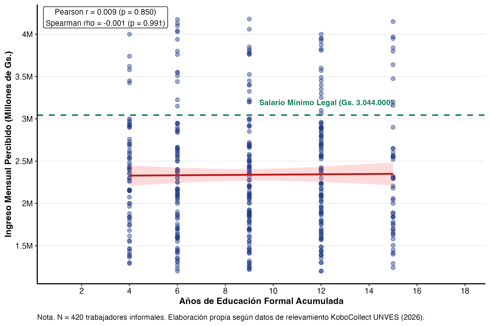
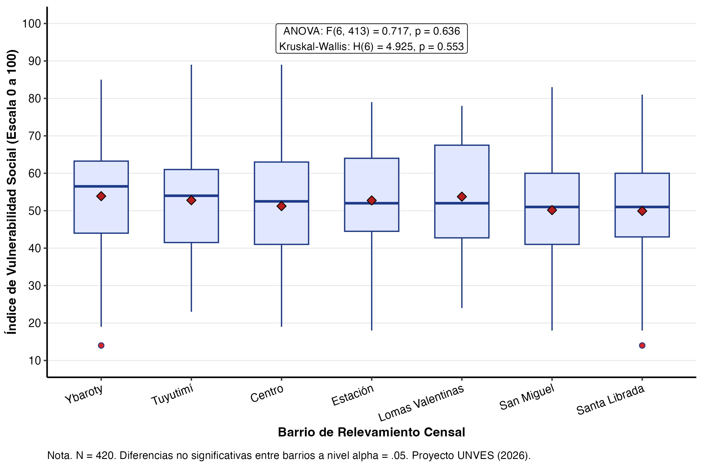
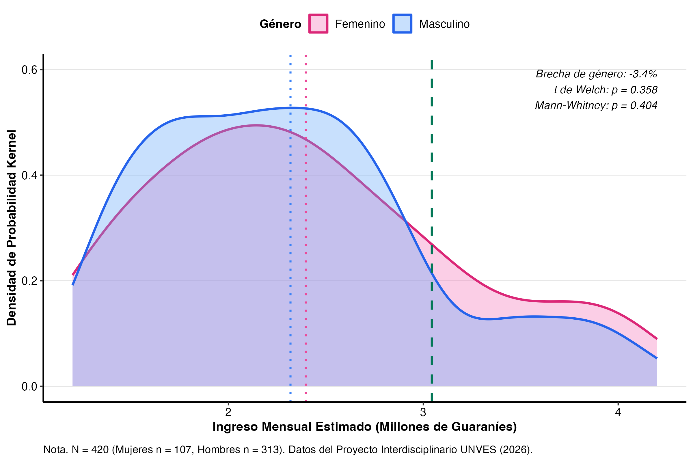
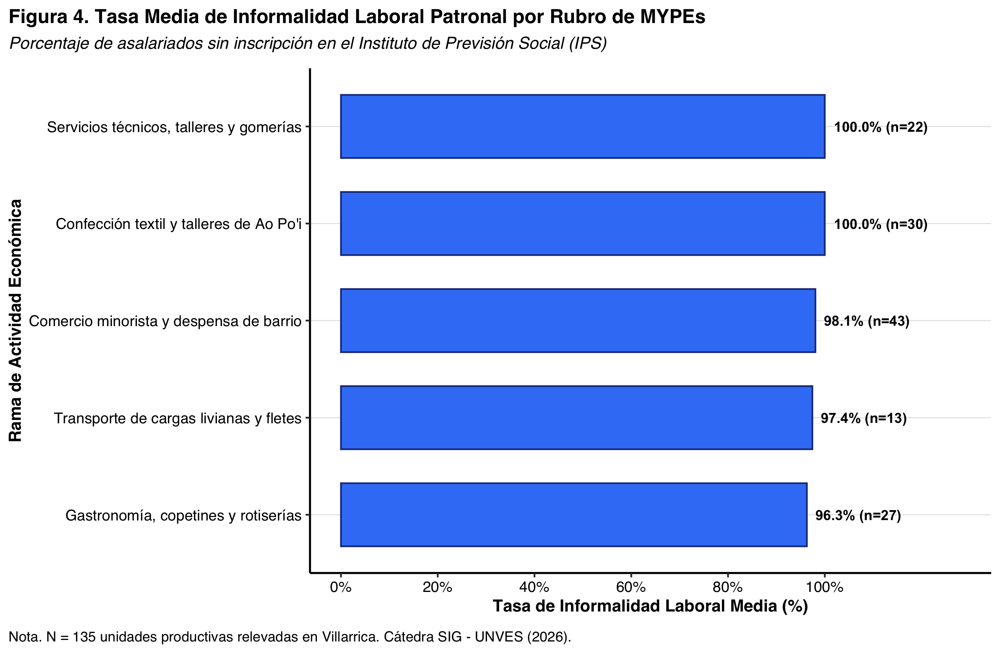
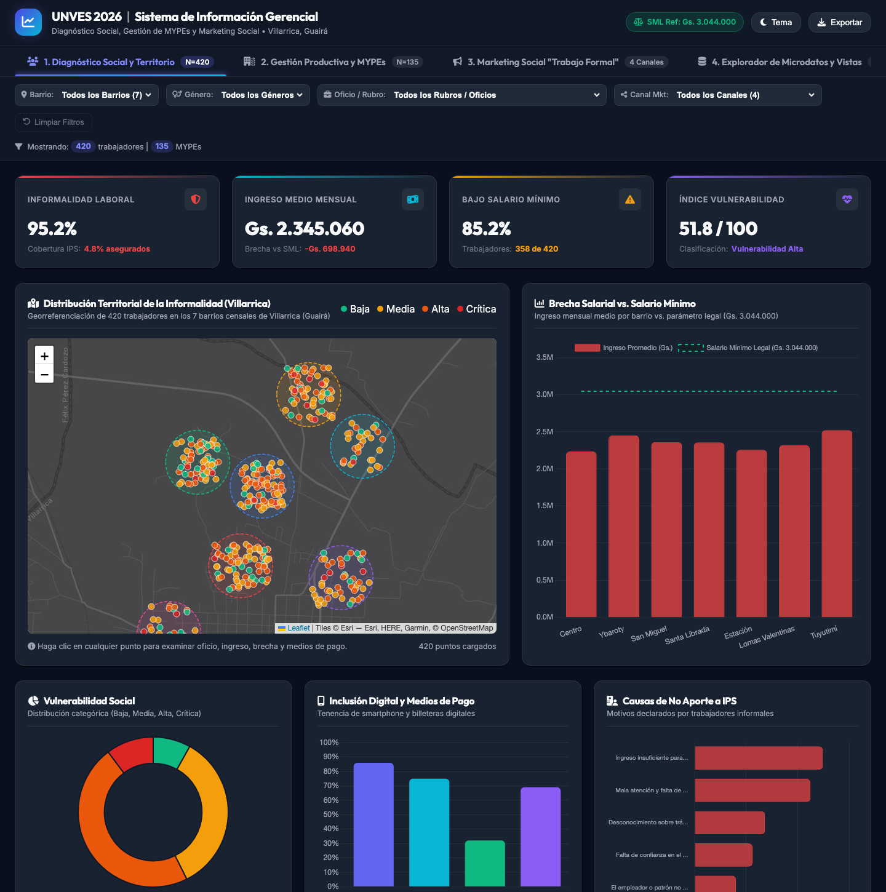
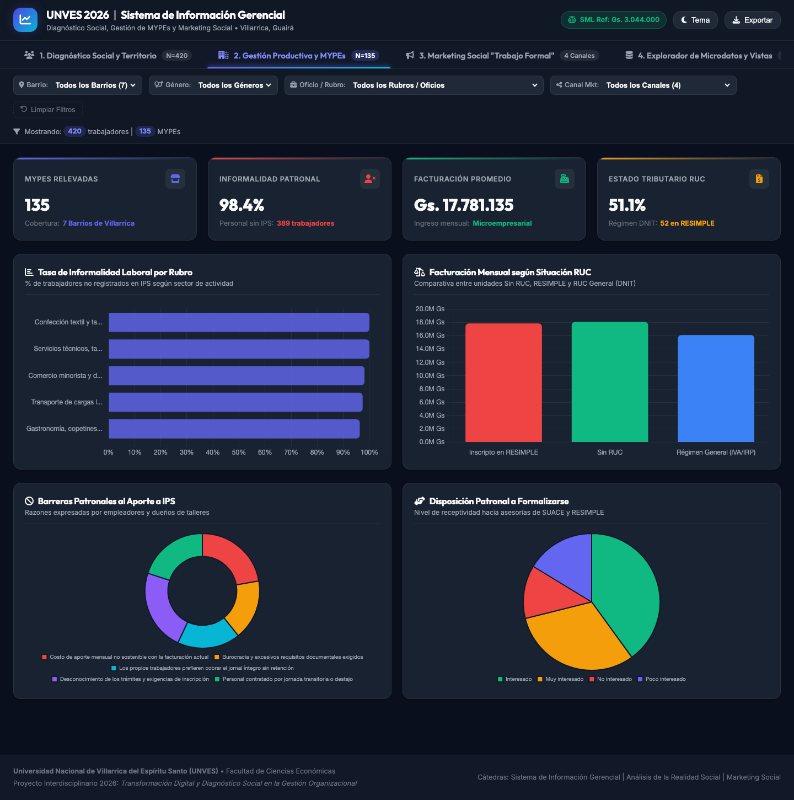
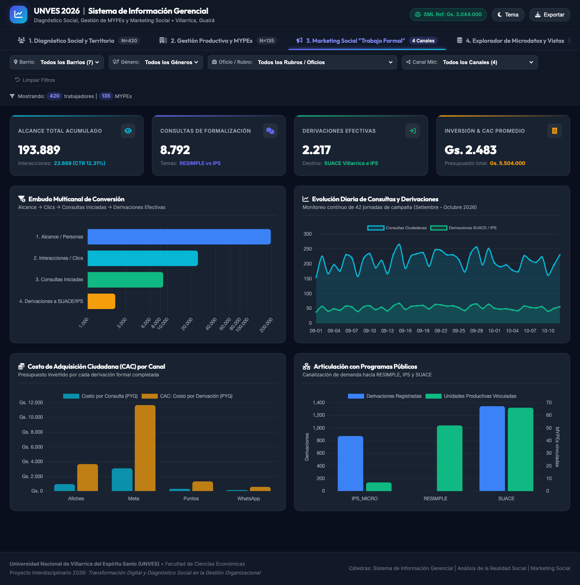
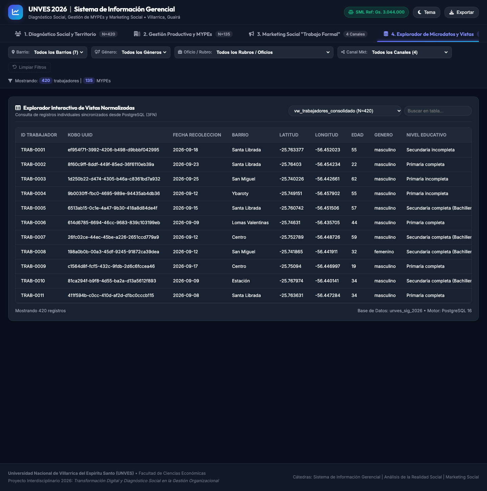
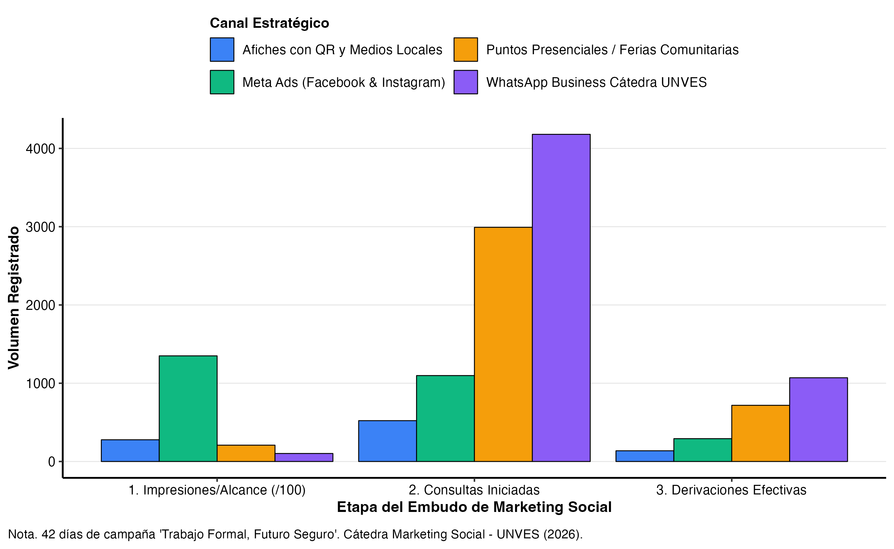

::: {custom-style="Title"}
UNIVERSIDAD NACIONAL DE VILLARRICA DEL ESPÍRITU SANTO
:::

::: {custom-style="Subtitle"}
FACULTAD DE CIENCIAS ECONÓMICAS
Carrera de Licenciatura en Administración de Empresas — Sede Central Villarrica
Proyecto Interdisciplinario 8.° Semestre — Año Lectivo 2026
:::

&nbsp;

::: {custom-style="Title"}
Transformación Digital y Diagnóstico Social en la Gestión Organizacional: La Informalidad Laboral en el Municipio de Villarrica
:::

::: {custom-style="Subtitle"}
Informe Académico Interdisciplinario Institucional
:::

&nbsp;

::: {custom-style="Portada"}
**Problemática social:** La Informalidad Laboral en el Paraguay (caso: municipio de Villarrica)
**Semestre:** 8.° Semestre — 4.° Curso

**Cátedras intervinientes:** Sistema de Información Gerencial (SIG) · Análisis de la Realidad Social del Paraguay · Marketing Social

**Docentes responsables:**
Prof. Mag. Clara Demattei (Sistema de Información Gerencial)
Prof. Mag. Gerardo Ortiz (Análisis de la Realidad Social del Paraguay)
Prof. Dra. Ramona Demattei (Marketing Social)

**Integrantes del equipo:**

| N.° | Apellidos y Nombres | C.I. N.° | Rol en el proyecto |
| :---: | :--- | :---: | :--- |
| 1 | [COMPLETAR] | [COMPLETAR] | [COMPLETAR] |
| 2 | [COMPLETAR] | [COMPLETAR] | [COMPLETAR] |
| 3 | [COMPLETAR] | [COMPLETAR] | [COMPLETAR] |
| 4 | [COMPLETAR] | [COMPLETAR] | [COMPLETAR] |

**Villarrica, Departamento del Guairá, República del Paraguay — Octubre de 2026**
:::

```{=openxml}
<w:p><w:r><w:br w:type="page"/></w:r></w:p>
```

**ÍNDICE DE CONTENIDOS**

```{=openxml}
<w:p><w:r><w:fldChar w:fldCharType="begin" w:dirty="true"/></w:r><w:r><w:instrText xml:space="preserve"> TOC \o "1-2" \h \z \u </w:instrText></w:r><w:r><w:fldChar w:fldCharType="separate"/></w:r><w:r><w:t>Clic derecho aquí y elegir "Actualizar campo" para generar el índice.</w:t></w:r><w:r><w:fldChar w:fldCharType="end"/></w:r></w:p>
```

```{=openxml}
<w:p><w:r><w:br w:type="page"/></w:r></w:p>
```

# RESUMEN EJECUTIVO {.unnumbered}

El presente informe expone los resultados del Proyecto Interdisciplinario *"Transformación Digital y Diagnóstico Social en la Gestión Organizacional: La Informalidad Laboral en el Paraguay"*, desarrollado en el municipio de Villarrica, Departamento del Guairá, durante el segundo semestre del año lectivo 2026. La investigación articuló la recolección de datos primarios georreferenciados mediante dispositivos móviles (Open Data Kit / KoboToolbox), el modelado relacional en Tercera Forma Normal (PostgreSQL 16), el análisis estadístico inferencial bajo normas APA 7.ª edición y la implementación de una estrategia de marketing social multicanal orientada a la formalización laboral.

A partir de un relevamiento territorial estratificado que abarcó a $N = 420$ trabajadores informales y $N = 135$ micro y pequeñas empresas (MYPEs) en siete barrios urbanos y periurbanos de Villarrica, se constató que el 85.24% de los trabajadores percibe ingresos inferiores al salario mínimo legal vigente (Gs. 3.044.000), con un ingreso medio de Gs. 2.345.060 y un déficit salarial medio de Gs. -698.940 respecto a dicho parámetro. En materia de seguridad social, el 95.24% de los trabajadores carece de cobertura en el Instituto de Previsión Social (IPS); solo el 4.76% (20 personas) cuenta con aseguramiento. La correlación entre años de escolaridad e ingresos resultó nula y no significativa ($r = 0.0163$, $p = .739$; $\rho = 0.0091$, $p = .852$), y la función semilogarítmica de capital humano de Mincer no alcanzó significancia conjunta ($F(4, 415) = 0.2272$, $p = .9231$, $R^2_{\text{ajustado}} = -0.0074$), con un coeficiente de escolaridad indistinguible de cero ($\beta = 0.00078$, $p = .860$). Este resultado es consistente con la hipótesis de una "trampa de informalidad".

En el tejido empresarial, las 135 MYPEs emplean a 396 trabajadores dependientes, de los cuales 389 no están inscriptos en el IPS (tasa media de informalidad laboral patronal del 98.4%). El 51.1% de los establecimientos opera sin RUC y el 30.4% cobra exclusivamente en efectivo. El principal motivo patronal de no inscripción es el desconocimiento de los trámites y exigencias de inscripción (23.0%), seguido del costo del aporte (22.2%). Frente a esta problemática, la campaña de marketing social *"Trabajo Formal, Futuro Seguro"* operó durante 42 días continuos (del 01 de setiembre al 12 de octubre de 2026) sobre cuatro canales (Meta Ads, WhatsApp Business, Puntos Presenciales y Afiches con QR). Con una inversión de Gs. 5.504.000, la campaña alcanzó a 193.889 personas, generó 23.869 interacciones y 8.792 consultas (5.337 sobre RESIMPLE y 3.455 sobre IPS), y canalizó 2.217 derivaciones efectivas hacia la ventanilla SUACE (1.344) y la Agencia Regional del IPS (873). Los canales de proximidad (WhatsApp y Puntos Presenciales) resultaron sustancialmente más costo-eficientes (Gs. 151 y Gs. 321 por consulta) que la pauta digital masiva (Gs. 3.106). Los hallazgos aportan evidencia para reorientar las políticas públicas locales hacia un modelo de ventanilla única descentralizada y educación tributaria aplicada.

*Palabras clave:* informalidad laboral, sistema de información gerencial, salario mínimo, trampa de informalidad, marketing social, políticas públicas, Villarrica.


```{=openxml}
<w:p><w:r><w:br w:type="page"/></w:r></w:p>
```

# INTRODUCCIÓN

La informalidad laboral es uno de los rasgos estructurales del mercado de trabajo paraguayo y una de las principales barreras para el acceso a la seguridad social, al crédito y a la protección ante contingencias de salud y vejez. Este informe documenta el trabajo conjunto de tres cátedras del 8.° semestre de la Licenciatura en Administración de Empresas de la FCE-UNVES, que abordaron el fenómeno en el municipio de Villarrica desde tres ángulos complementarios: el diagnóstico social (Análisis de la Realidad Social del Paraguay), la gestión de datos y el soporte a decisiones (Sistema de Información Gerencial) y la intervención comunicacional (Marketing Social).

El documento se organiza de la siguiente manera: la sección 1 presenta la fundamentación y el marco teórico; la sección 2, los objetivos; la sección 3, la metodología de relevamiento y gobernanza de datos; las secciones 4, 5 y 6 corresponden a los capítulos de cada cátedra; la sección 7 expone las conclusiones, recomendaciones y limitaciones. Las referencias bibliográficas y los anexos con las evidencias digitales cierran el informe.


```{=openxml}
<w:p><w:r><w:br w:type="page"/></w:r></w:p>
```

# 1. FUNDAMENTACIÓN Y MARCO TEÓRICO INTERDISCIPLINARIO

El vínculo entre lo social, la tecnología y el marketing social responsable permite que los futuros administradores desarrollen propuestas de valor con impacto social y herramientas digitales para su gestión (UNVES, 2026). La persistencia de la informalidad laboral en la economía paraguaya representa una de las fallas de mercado más pronunciadas y una barrera crítica para el desarrollo socioeconómico sostenible. De acuerdo con la Organización Internacional del Trabajo (OIT, 2023) y el Instituto Nacional de Estadística (INE, 2024), más del 60% de la población ocupada no agropecuaria del país se desempeña en condiciones de informalidad, caracterizadas por la ausencia de aportes previsionales, la exclusión de registros tributarios y la inestabilidad de los ingresos. El Ministerio de Trabajo, Empleo y Seguridad Social (MTESS, 2024) ha subrayado que este fenómeno compromete la productividad y perpetúa la desprotección social.

En ciudades intermedias del interior como Villarrica, capital del Departamento del Guairá, esta problemática adquiere dinámicas territoriales singulares. La coexistencia de oficios tradicionales (confección artesanal de Ao Po'i, zapatería, comercio minorista en ferias municipales) con actividades emergentes de servicios y transporte informal configura un tejido productivo fragmentado y vulnerable.

La Facultad de Ciencias Económicas de la UNVES responde a este escenario mediante un enfoque interdisciplinario estructurado por tres cátedras:

1. **Análisis de la Realidad Social del Paraguay:** aporta el marco sociológico, económico e institucional para diagnosticar los indicadores de bienestar, pobreza y vulnerabilidad laboral en el Guairá.
2. **Sistema de Información Gerencial (SIG):** provee el andamiaje tecnológico necesario para estandarizar la captura, garantizar la calidad de la información mediante normalización relacional en 3FN y facilitar la explotación analítica para la toma de decisiones.
3. **Marketing Social:** siguiendo el marco metodológico de Lee y Kotler (2019), diseña e implementa estrategias de comunicación orientadas a modificar percepciones ciudadanas respecto a los beneficios de la formalización, articulando la demanda ciudadana con las soluciones públicas disponibles: el régimen RESIMPLE de la Dirección Nacional de Ingresos Tributarios (DNIT, 2024), el seguro social del Instituto de Previsión Social (IPS, 2024) y el SUACE del Ministerio de Industria y Comercio (MIC, 2024).


```{=openxml}
<w:p><w:r><w:br w:type="page"/></w:r></w:p>
```

# 2. OBJETIVOS

## 2.1 Objetivo General

Diagnosticar la informalidad laboral en el municipio de Villarrica y diseñar un sistema de información gerencial que, articulado con una campaña de marketing social basada en datos, apoye la toma de decisiones orientadas a la formalización laboral.

## 2.2 Objetivos Específicos

1. Diagnosticar las condiciones de ingreso, seguridad social, educación, vulnerabilidad y localización geográfica de los trabajadores informales y de las MYPEs de Villarrica.
2. Diseñar e implementar una base de datos relacional normalizada (3FN) que integre las entidades Trabajadores, Unidades Productivas, Programas de Formalización e Indicadores Sociales.
3. Implementar formularios digitales móviles para la captura de datos primarios georreferenciados en terreno.
4. Construir un tablero de control (dashboard) interactivo que permita visualizar los indicadores clave para la toma de decisiones.
5. Proponer y evaluar una campaña de marketing social basada en datos, incorporando sus métricas de seguimiento (alcance, interacciones, consultas y derivaciones) al sistema.


```{=openxml}
<w:p><w:r><w:br w:type="page"/></w:r></w:p>
```

# 3. METODOLOGÍA DEL RELEVAMIENTO Y GOBERNANZA DE DATOS

## 3.1 Diseño Muestral y Cobertura Espacial

En apego a las directrices de la guía docente del proyecto (UNVES, 2026), se aplicó un muestreo probabilístico estratificado por conglomerados espaciales en siete barrios representativos del municipio de Villarrica: Centro, Ybaroty, San Miguel, Santa Librada, Estación, Lomas Valentinas y Tuyutimí. El tamaño muestral se fijó en $N = 420$ trabajadores informales y $N = 135$ unidades productivas (microempresas, talleres y puestos comerciales). Para un nivel de confianza del 95% y máxima varianza ($p = 0.5$), una muestra de 420 casos implica un margen de error de aproximadamente ±4.8%.

## 3.2 Instrumento de Captura y Control de Calidad

La recolección se efectuó mediante dispositivos móviles con la tecnología de código abierto **Open Data Kit (ODK)** sobre la plataforma **KoboToolbox**. La boleta digital (`kobo/encuesta_informalidad_villarrica_2026.xlsx`) incorporó:

- Captura de coordenadas geográficas por GPS con umbral de precisión controlado en terreno (inferior a 10 metros).
- Validación lógica de tipos y rangos numéricos para prevenir inconsistencias de captura.
- Funcionamiento *offline-first*, que permite continuar el levantamiento en zonas sin cobertura celular y sincronizar los formularios por HTTPS al recuperar la conexión.
- Registro temporal bajo el huso horario oficial de la República del Paraguay (UTC-3), conforme a la Ley N.° 7354/2024.

## 3.3 Procesamiento y Análisis

Los datos exportados de KoboToolbox fueron procesados mediante un pipeline ETL en Python que valida tipos y coordenadas, calcula los indicadores sociales (entre ellos el Índice de Vulnerabilidad Social, IVS) y carga los registros en PostgreSQL 16. El análisis estadístico se realizó en R (versión 4.x) mediante estadística descriptiva, correlaciones de Pearson y Spearman, regresión lineal (función de Mincer), ANOVA de una vía, prueba de Kruskal-Wallis, prueba $t$ de Welch y prueba de Mann-Whitney, con un nivel de significancia $\alpha = .05$.

## 3.4 Consideraciones Éticas

Antes de cada entrevista se leyó y solicitó el consentimiento informado de la persona entrevistada. Los registros se identifican mediante códigos institucionales (`TRAB-0001` a `TRAB-0420`, `MYPE-VIL-001` a `MYPE-VIL-135`) y no se publican nombres ni datos de contacto personales; los resultados se presentan en forma agregada.


```{=openxml}
<w:p><w:r><w:br w:type="page"/></w:r></w:p>
```

# 4. CAPÍTULO I: DIAGNÓSTICO DE LA REALIDAD SOCIAL Y ANÁLISIS ESTADÍSTICO

## 4.1 Brecha Salarial y Salario Mínimo Legal

El salario mínimo legal vigente de referencia en el Paraguay asciende a Gs. 3.044.000 mensuales. La evaluación de los $N = 420$ trabajadores relevados revela que el ingreso medio mensual se sitúa en Gs. 2.345.060 ($DE = 725.694$), lo que implica una brecha salarial negativa promedio de Gs. -698.940 respecto al piso legal.

El 85.24% de los trabajadores informales (358 personas) percibe ingresos inferiores al salario mínimo legal; el 50% central se concentra entre Gs. 1.838.750 y Gs. 2.900.000 ($IQR = 1.061.250$), con una mediana de Gs. 2.332.500. En cuanto a la cobertura previsional, el 95.24% carece de seguro médico o jubilación en el IPS; la cobertura se limita al 4.76% (20 trabajadores), que aportan bajo la modalidad de cotización voluntaria independiente o figuran como beneficiarios familiares.

**Tabla 1**

*Estadísticas Descriptivas de las Variables Socioeconómicas y Laborales de los Trabajadores Informales (N = 420)*

| Variable | Media | DE | Mediana | IQR | Mínimo | Máximo |
| :--- | :---: | :---: | :---: | :---: | :---: | :---: |
| Ingreso Mensual (PYG) | 2.345.060 | 725.694 | 2.332.500 | 1.061.250 | 1.200.000 | 4.160.000 |
| Brecha Salarial (PYG) | -698.940 | 725.694 | -711.500 | 1.061.250 | -1.844.000 | 1.116.000 |
| Años de Escolaridad | 8,96 | 3,49 | 9,00 | 6,00 | 4,00 | 15,00 |
| Edad (Años) | 42,58 | 14,38 | 43,00 | 25,00 | 18,00 | 67,00 |
| Horas Semanales de Labor | 45,72 | 12,82 | 45,00 | 23,25 | 24,00 | 67,00 |
| Índice Vulnerabilidad Social | 51,78 | 14,88 | 52,50 | 20,00 | 10,00 | 96,00 |

*Nota.* Elaboración propia con base en el relevamiento KoboToolbox/ODK (UNVES, 2026). $DE$ = desviación estándar; $IQR$ = rango intercuartílico. Parámetro de comparación: salario mínimo legal = Gs. 3.044.000.

## 4.2 Retornos de la Educación en el Sector Informal

Uno de los postulados de la economía laboral (Mincer, 1974) sostiene que cada año adicional de escolaridad formal genera retornos salariales positivos. Sin embargo, en el segmento informal de Villarrica, la correlación de Pearson entre años de estudio e ingreso mensual es prácticamente nula y no significativa ($r = 0.0163$, $t(418) = 0.334$, $p = .739$, IC 95% $[-0.0795, 0.1118]$). La correlación de Spearman corrobora la ausencia de relación monótona ($\rho = 0.0091$, $p = .852$).

Para evaluar los determinantes de las remuneraciones en el mercado informal local, se estimó la función de ingresos de Mincer:

$$\ln(\text{Ingreso}_i) = \beta_0 + \beta_1 (\text{Escolaridad}_i) + \beta_2 (\text{Experiencia}_i) + \beta_3 (\text{Edad}_i) + \beta_4 (\text{Género}_i) + \varepsilon_i$$

**Tabla 2**

*Estimación del Modelo de Capital Humano de Mincer para el Sector Informal de Villarrica*

| Coeficiente | Estimación ($\beta$) | Error Estándar | Estadístico $t$ | Valor $p$ |
| :--- | :---: | :---: | :---: | :---: |
| Intercepto ($\beta_0$) | 14,6584 | 0,0687 | 213,381 | $< .001$ |
| Años de Escolaridad ($\beta_1$) | 0,0008 | 0,0044 | 0,177 | ,860 |
| Antigüedad en Oficio ($\beta_2$) | -0,0007 | 0,0021 | -0,333 | ,740 |
| Edad ($\beta_3$) | -0,0006 | 0,0013 | -0,441 | ,660 |
| Género Masculino ($\beta_4$) | -0,0178 | 0,0358 | -0,498 | ,619 |

*Nota.* Variable dependiente: $\ln$(ingreso mensual en PYG). $N = 420$. $R^2 = 0.0022$; $R^2_{\text{ajustado}} = -0.0074$; $F(4, 415) = 0.2272$, $p = .9231$.

Como se observa en la Tabla 2, el modelo carece de significancia estadística conjunta ($p = .9231$) y el coeficiente de escolaridad es indistinguible de cero ($\beta_1 = 0.00078$, $p = .860$). Este resultado es consistente con la existencia de una *trampa de informalidad*: en el segmento relevado, los años de formación básica o secundaria no se traducen en primas salariales cuando el trabajador carece de acceso a capital de trabajo, certificación de competencias o inserción formal en cadenas de valor. Cabe señalar que la ausencia de significancia no demuestra por sí sola un efecto nulo; indica que, con los datos disponibles, no se detecta una relación entre escolaridad e ingreso.

**Figura 1**

*Correlación entre Años de Escolaridad e Ingreso Mensual en Guaraníes*

{width=100%}

*Nota.* Elaboración en R con datos del relevamiento UNVES (2026). La línea discontinua indica el salario mínimo legal (Gs. 3.044.000).

## 4.3 Homogeneidad Territorial de la Vulnerabilidad Social

Se evaluó si la vulnerabilidad socioeconómica, medida por el Índice de Vulnerabilidad Social (IVS, 0 a 100 puntos), se concentra en barrios periféricos o responde a un patrón uniforme en la trama urbana de Villarrica.

**Tabla 3**

*Índice de Vulnerabilidad Social e Ingresos por Barrio de Villarrica (N = 420)*

| Barrio | $n$ | IVS Medio | $DE$ | IVS Mediana | IQR | Ingreso Medio (PYG) | % Bajo Mínimo |
| :--- | :---: | :---: | :---: | :---: | :---: | :---: | :---: |
| Centro | 90 | 54,96 | 13,68 | 57,00 | 18,00 | 2.232.833 | 91,11% |
| San Miguel | 63 | 52,68 | 13,58 | 52,00 | 15,50 | 2.359.365 | 87,30% |
| Estación | 51 | 52,65 | 16,04 | 52,00 | 20,50 | 2.256.078 | 82,35% |
| Ybaroty | 68 | 51,40 | 17,34 | 53,00 | 26,75 | 2.448.824 | 76,47% |
| Lomas Valentinas | 32 | 50,00 | 12,55 | 47,50 | 17,50 | 2.316.563 | 87,50% |
| Tuyutimí | 39 | 49,23 | 15,44 | 48,00 | 23,50 | 2.520.000 | 82,05% |
| Santa Librada | 77 | 49,10 | 14,42 | 52,00 | 22,00 | 2.355.065 | 87,01% |

*Nota.* IVS = Índice de Vulnerabilidad Social (0 a 100). Prueba de normalidad de Shapiro-Wilk: $W = 0.9942$, $p = .1084$; prueba de homocedasticidad de Bartlett: $K^2 = 8.0323$, $p = .2357$. ANOVA de una vía: $F(6, 413) = 1.449$, $p = .1944$. Prueba de Kruskal-Wallis: $H(6) = 8.6318$, $p = .1954$.

Dado que los contrastes resultaron no significativos ($p > .05$), no se encontró evidencia de segmentación barrial: la precariedad laboral informal se presenta como un fenómeno estructural relativamente homogéneo, tanto en el microcentro comercial como en los sectores periféricos.

**Figura 2**

*Índice de Vulnerabilidad Social en los Siete Barrios Relevados de Villarrica*

{width=100%}

*Nota.* Diagrama de cajas; los rombos indican la media de cada barrio. Elaboración en R con datos del relevamiento UNVES (2026).

## 4.4 Análisis Salarial por Género

Las trabajadoras informales perciben un ingreso medio de Gs. 2.373.107 ($DE = 732.251$, $n = 103$), frente a Gs. 2.335.946 ($DE = 724.481$, $n = 317$) de los varones. La diferencia muestral (Gs. 37.160 a favor de las mujeres, 1.59%) no es estadísticamente significativa.

**Tabla 4**

*Brecha Salarial de Género en el Mercado Informal de Villarrica*

| Género | $n$ | Ingreso Medio (PYG) | $DE$ (PYG) | Mediana (PYG) | Diferencia vs. masculino (PYG) | Diferencial % |
| :--- | :---: | :---: | :---: | :---: | :---: | :---: |
| Femenino | 103 | 2.373.107 | 732.251 | 2.340.000 | +37.160 | +1,59% |
| Masculino | 317 | 2.335.946 | 724.481 | 2.330.000 | Ref. | Ref. |

*Nota.* Prueba $t$ de Welch para varianzas heterogéneas: $t(171.60) = 0.4486$, $p = .6543$. Prueba de Mann-Whitney: $W = 16.906,5$, $p = .5875$.

Ambos grupos se encuentran por debajo del salario mínimo legal en promedio, sin que se verifique una diferencia de ingresos por género estadísticamente detectable en el sector no registrado.

**Figura 3**

*Distribución de Ingresos Mensuales por Género frente al Salario Mínimo Legal*

{width=100%}

*Nota.* Curvas de densidad kernel; las líneas punteadas indican las medias por género y la línea discontinua el salario mínimo legal.

## 4.5 Unidades Productivas (MYPEs) e Informalidad Patronal

El relevamiento de $N = 135$ unidades productivas registró una dotación conjunta de 396 trabajadores dependientes, de los cuales 389 no están inscriptos en el IPS. La tasa media de informalidad laboral patronal se ubicó en el 98.4%, con valores que van del 96.3% (gastronomía) al 100% (confección textil y servicios técnicos).

**Figura 4**

*Tasa Media de Informalidad Laboral en las MYPEs por Rubro Económico*

{width=100%}

*Nota.* Porcentaje de trabajadores dependientes sin inscripción en el IPS; $n$ = cantidad de MYPEs por rubro.

En materia tributaria, el 51.1% de los establecimientos carece de inscripción en el Registro Único del Contribuyente (RUC), el 38.5% está inscripto en el RESIMPLE y el 10.4% en el régimen general. En cuanto a medios de cobro, el 30.4% opera exclusivamente en efectivo, mientras que el resto combina el efectivo con billeteras móviles, QR o transferencias, en línea con el avance de la digitalización de pagos reportado por el Banco Central del Paraguay (BCP, 2025).

Respecto de los motivos patronales de no inscripción en el IPS (IPS, 2024), el principal es el desconocimiento de los trámites y exigencias de inscripción (23.0%), seguido del costo del aporte mensual frente a la facturación (22.2%), la contratación por jornada transitoria o a destajo (20.0%), la preferencia de los propios trabajadores por cobrar el jornal íntegro (17.8%) y la burocracia documental (17.0%). Entre los 400 trabajadores sin cobertura, los motivos declarados de no aporte fueron: ingreso insuficiente para afrontar el costo mensual (31.0%), mala atención y falta de medicamentos en el hospital regional del IPS (28.0%), desconocimiento de los trámites del régimen de independientes (17.0%), falta de confianza en el retorno jubilatorio (14.0%) y que el empleador no realiza la inscripción (10.0%).


```{=openxml}
<w:p><w:r><w:br w:type="page"/></w:r></w:p>
```

# 5. CAPÍTULO II: SISTEMA DE INFORMACIÓN GERENCIAL Y ARQUITECTURA TECNOLÓGICA

Para dar respuesta operativa al diagnóstico social, la Cátedra de SIG estructuró una arquitectura integral de datos. La documentación técnica completa (diccionario de datos, manual de instalación y manual de usuario) se presenta en el Anexo A (`docs/capitulo_sig.md`); en esta sección se resumen sus componentes principales.

## 5.1 Arquitectura Tecnológica

La solución se organiza en cinco capas:

1. **Captura digital (nube):** formularios XLSForm publicados en el servidor de KoboToolbox (`kf.kobotoolbox.org`) y completados con KoboCollect/ODK Collect en teléfonos Android, con funcionamiento sin conexión y sincronización por HTTPS.
2. **Procesamiento (ETL en Python):** ingesta de la exportación de KoboToolbox, validación de tipos, rangos y coordenadas, cálculo de los indicadores sociales y carga idempotente (`INSERT ... ON CONFLICT DO UPDATE`).
3. **Persistencia (PostgreSQL 16):** base de datos relacional en 3FN con integridad referencial, restricciones de dominio e índices B-Tree.
4. **Análisis (R):** estimaciones estadísticas y generación de las figuras APA.
5. **Visualización:** dashboard gerencial web (HTML5, Leaflet y Chart.js). Las vistas analíticas de PostgreSQL también pueden consumirse desde Power BI o Tableau mediante su conector nativo para PostgreSQL.

**Justificación de las herramientas.** Se eligió PostgreSQL por ser un motor de código abierto, sin costo de licencia, con cumplimiento ACID y soporte nativo de tipos geográficos y vistas; KoboToolbox por ser gratuito para fines académicos y humanitarios, funcionar sin conexión y exportar directamente a CSV/JSON; y un dashboard web autónomo porque puede abrirse en cualquier navegador sin instalar software ni adquirir licencias, lo que facilita su uso por la Municipalidad y las oficinas regionales.

## 5.2 Modelo Entidad-Relación

El esquema relacional (`db/schema.sql`) está normalizado en Tercera Forma Normal y se compone de 13 tablas y 4 vistas analíticas:

- **6 tablas de catálogo:** `barrios`, `oficios`, `rubros_mypes`, `medios_pago`, `canales_marketing` y `programas_formalizacion` (ID Programa).
- **5 tablas maestras y transaccionales:** `trabajadores` (ID Trabajador), `indicadores_sociales` (ID Indicador, relación 1:1 con trabajadores), `unidades_productivas` (ID Empleador / Unidad), `marketing_kpis` y `derivaciones_programas` (2.217 registros que vinculan trabajador, canal y programa).
- **2 tablas asociativas N:M:** `trabajadores_medios_pago` y `unidades_medios_pago`.
- **4 vistas analíticas:** `vw_trabajadores_consolidado`, `vw_unidades_productivas_consolidado`, `vw_marketing_resumen_canales` y `vw_articulacion_programas_formalizacion`.

**Figura 5**

*Diagrama Entidad-Relación del Sistema de Información Gerencial (3FN)*

{width=100%}

*Nota.* Elaboración propia a partir del catálogo de PostgreSQL. PK = clave primaria; FK = clave foránea; UQ = clave única. Azul: catálogos; verde: tablas maestras y transaccionales; amarillo: tablas asociativas N:M. Se muestran las claves; los demás atributos figuran en el diccionario de datos (Anexo A). La relación `trabajadores`–`indicadores_sociales` es 1:1 (restricción `UNIQUE` sobre `trabajador_id`). Versión interactiva en `docs/diagrama_er.html`.

## 5.3 Articulación con Análisis de la Realidad Social

La tabla `trabajadores` almacena las variables de ubicación geográfica (barrio, latitud y longitud), ingreso, cobertura IPS y conectividad, mientras que `indicadores_sociales` almacena los 10 indicadores calculados por la cátedra de Realidad Social: brecha respecto al salario mínimo, situación frente al mínimo, condición de jornada, nivel educativo, años de estudio, brecha digital, aceptación de pagos digitales, personas a cargo, tenencia de vivienda e Índice de Vulnerabilidad Social con su clasificación. Las coordenadas GPS se validan con restricciones `CHECK` dentro del perímetro de Villarrica.

## 5.4 Articulación con Marketing Social

La tabla `marketing_kpis` registra la serie diaria (42 días × 4 canales = 168 registros) de alcance, interacciones, CTR, consultas por tema (RESIMPLE / IPS), derivaciones y presupuesto. La tabla `derivaciones_programas` registra cada una de las 2.217 derivaciones de forma individual, con su canal de origen, programa de destino y estado del trámite, lo que permite seguir el flujo de interesados hacia los portales y ventanillas de formalización.

## 5.5 Pruebas de Integridad y Rendimiento

La verificación de calidad (Sesión 12) se ejecutó con el script `db/test_db_integrity.py` sobre la base `unves_sig_2026`, con los siguientes resultados:

- **Integridad referencial:** 0 registros huérfanos en todas las claves foráneas.
- **Restricciones de dominio (CHECK):** 100% de los registros cumple las reglas de coherencia lógica.
- **No duplicidad:** los identificadores `kobo_uuid` y los códigos de trabajador, unidad y derivación son únicos.
- **Tiempos de respuesta:** las consultas analíticas de prueba se ejecutaron entre 0,7 y 2,2 ms, por debajo del umbral de 50 ms establecido.

## 5.6 Dashboard Gerencial Interactivo

El dashboard (`docs/dashboard.html`) consolida los indicadores en cuatro pestañas con filtros simultáneos por barrio, género, rubro y canal de marketing. Las Figuras 6 a 9 muestran cada una de ellas.

**Figura 6**

*Dashboard Gerencial — Pestaña 1: Diagnóstico Social y Territorio*

{width=100%}

*Nota.* Indicadores de informalidad, ingreso medio, porcentaje bajo el salario mínimo e IVS; mapa georreferenciado de los 420 trabajadores.

**Figura 7**

*Dashboard Gerencial — Pestaña 2: Gestión Productiva y MYPEs*

{width=100%}

*Nota.* Informalidad patronal por rubro, facturación según situación RUC, barreras patronales y disposición a formalizarse.

**Figura 8**

*Dashboard Gerencial — Pestaña 3: Marketing Social "Trabajo Formal, Futuro Seguro"*

{width=100%}

*Nota.* Embudo de conversión, evolución diaria de consultas y derivaciones, costo por canal y articulación con programas públicos.

**Figura 9**

*Dashboard Gerencial — Pestaña 4: Explorador de Microdatos y Vistas*

{width=100%}

*Nota.* Consulta de los registros individuales de las vistas analíticas, con búsqueda por texto.


```{=openxml}
<w:p><w:r><w:br w:type="page"/></w:r></w:p>
```

# 6. CAPÍTULO III: MARKETING SOCIAL Y ESTRATEGIA COMUNICACIONAL "TRABAJO FORMAL, FUTURO SEGURO"

La Cátedra de Marketing Social diseñó la campaña *"Trabajo Formal, Futuro Seguro"*, aplicando los principios de Lee y Kotler (2019) para sensibilizar a trabajadores informales y microempresarios sobre los beneficios de la formalización laboral y tributaria (acceso al crédito, jubilación y salud), promoviendo la articulación con los programas RESIMPLE (DNIT, 2024), el seguro social del IPS y el SUACE (MIC, 2024).

## 6.1 Desempeño del Embudo Multicanal

La campaña operó durante 42 días continuos (del 01 de setiembre al 12 de octubre de 2026) a través de cuatro canales:

**Tabla 5**

*Rendimiento Consolidado de la Campaña "Trabajo Formal, Futuro Seguro" por Canal*

| Canal | Alcance | Interacciones | CTR | Consultas | Derivaciones | Presupuesto (PYG) | Costo / Consulta (PYG) | Costo / Derivación (PYG) |
| :--- | :---: | :---: | :---: | :---: | :---: | :---: | :---: | :---: |
| WhatsApp Business | 10.243 | 8.205 | 80,09% | 4.180 | 1.070 | 630.000 | 151 | 589 |
| Puntos Presenciales / Ferias | 20.890 | 7.082 | 33,90% | 2.992 | 718 | 960.000 | 321 | 1.337 |
| Meta Ads (Facebook/Instagram) | 134.988 | 6.702 | 4,97% | 1.098 | 292 | 3.410.000 | 3.106 | 11.678 |
| Afiches QR y Medios Locales | 27.768 | 1.880 | 6,77% | 522 | 137 | 504.000 | 966 | 3.679 |
| **Total** | **193.889** | **23.869** | **12,31%** | **8.792** | **2.217** | **5.504.000** | **626** | **2.483** |

*Nota.* Moneda: guaraníes (PYG). Tipología de canales: WhatsApp (mensajería digital), Puntos Presenciales (BTL), Meta Ads (digital pago), Afiches QR (OOH / impreso). CTR = tasa de interacción (interacciones / alcance). De las 8.792 consultas, 5.337 trataron sobre RESIMPLE y 3.455 sobre IPS. Las 2.217 derivaciones se dirigieron a la ventanilla SUACE (1.344) y a la Agencia Regional del IPS (873).

**Figura 10**

*Embudo de Conversión Multicanal de la Campaña "Trabajo Formal, Futuro Seguro"*

{width=100%}

*Nota.* El alcance se presenta dividido por 100 para hacerlo comparable con las demás etapas. Embudo agregado: alcance 193.889 (100%) → interacciones 23.869 (12.3%) → consultas 8.792 (4.5%) → derivaciones 2.217 (1.1%).

## 6.2 Costo-Eficiencia por Canal

Los datos muestran una marcada asimetría de costo-eficiencia entre canales:

1. **Canales de alta proximidad y confianza:** WhatsApp Business y las ferias presenciales concentraron el 80.65% de las derivaciones efectivas (1.788 de 2.217) con apenas el 28.89% del presupuesto (Gs. 1.590.000). El costo por derivación en WhatsApp fue de Gs. 589.
2. **Canales de difusión masiva:** Meta Ads absorbió el 61.95% de los fondos (Gs. 3.410.000) pero generó solo el 13.17% de las derivaciones (292), con un costo por derivación de Gs. 11.678, unas 20 veces superior al de WhatsApp. En el segmento informal, la pauta digital masiva resulta insuficiente si no va acompañada de un canal de atención asistida y personalizada.


```{=openxml}
<w:p><w:r><w:br w:type="page"/></w:r></w:p>
```

# 7. CONCLUSIONES, RECOMENDACIONES Y LIMITACIONES

## 7.1 Conclusiones

1. **Naturaleza estructural de la informalidad:** en Villarrica, la informalidad se presenta como un equilibrio de bajo nivel: el 85.24% de los trabajadores relevados percibe ingresos inferiores al salario mínimo legal y el 95.24% carece de seguro en el IPS. Del lado patronal, el 98.4% de los dependientes de las MYPEs no está inscripto.
2. **Ausencia de retorno educativo detectable:** no se encontró relación entre años de escolaridad e ingreso ($r = 0.0163$, $p = .739$), lo que sugiere que la educación formal, por sí sola, no basta para salir de la precariedad sin acceso a capital de trabajo, herramientas tecnológicas o formalización tributaria.
3. **Homogeneidad territorial:** la vulnerabilidad no difiere significativamente entre barrios ($F(6, 413) = 1.449$, $p = .194$), por lo que las intervenciones deben tener alcance distrital y no limitarse a la periferia.
4. **Desinformación como barrera central:** el desconocimiento de los trámites es el primer motivo patronal de no inscripción (23.0%) y figura entre los motivos de los trabajadores (17.0%).
5. **Efectividad del SIG interdisciplinario:** la integración de captura móvil, base de datos normalizada y dashboard permitió identificar que los canales de proximidad son hasta 20 veces más eficientes por derivación, información directamente utilizable para reasignar recursos.

## 7.2 Recomendaciones de Políticas Públicas para Villarrica

1. **Ventanilla única móvil de formalización (SUACE - DNIT - IPS):** en línea con el MTESS (2024), implementar brigadas interinstitucionales que visiten periódicamente mercados y ferias barriales (Centro, San Miguel, Estación) para tramitar en el acto la inscripción en RESIMPLE y la inscripción patronal en el IPS.
2. **Difusión de regímenes específicos:** capacitar a microempresarios en los alcances de la Ley N.° 5741/16 y de la Ley N.° 4933/13 (incorporación voluntaria de trabajadores independientes al IPS), atacando el desconocimiento detectado.
3. **Estrategia comunicacional basada en asistencia directa:** priorizar la inversión en mensajería asistida (WhatsApp) y promotores de campo por sobre la pauta publicitaria masiva.
4. **Continuidad del SIG:** mantener la base de datos y el dashboard como herramienta de seguimiento de las derivaciones, incorporando el estado final de cada trámite.

## 7.3 Limitaciones

- El relevamiento es de corte transversal: describe la situación en setiembre-octubre de 2026 y no permite inferir causalidad.
- Los ingresos son autodeclarados, por lo que pueden contener sesgos de subdeclaración o redondeo.
- El modelo de Mincer presenta un $R^2$ muy bajo; otras variables no relevadas (capital de trabajo, acceso al crédito, rubro específico) podrían explicar mejor la variabilidad del ingreso.
- Las métricas de la campaña miden derivaciones, no formalizaciones concluidas; el seguimiento del estado final de los trámites excede el período del proyecto.
- El dashboard trabaja sobre una exportación de la base de datos y requiere volver a ejecutar el pipeline para reflejar datos nuevos.


```{=openxml}
<w:p><w:r><w:br w:type="page"/></w:r></w:p>
```

# REFERENCIAS {.unnumbered}

Banco Central del Paraguay. (2025). *Informe de inclusión financiera y digitalización de medios de pago en el Paraguay*. BCP. https://www.bcp.gov.py

Dirección Nacional de Ingresos Tributarios. (2024). *Régimen Simplificado para Pequeñas Unidades Económicas (RESIMPLE): Guía técnica y tributaria* (Ley N.° 6380/19). DNIT. https://www.dnit.gov.py

Instituto de Previsión Social. (2024). *Manual operativo de cobertura de seguridad social para trabajadores independientes y microempresas* (Leyes N.° 4933/13 y N.° 5741/16). Dirección de Aporte Obrero Patronal, IPS.

Instituto Nacional de Estadística. (2024). *Encuesta Permanente de Hogares Continua (EPHC 2023-2024): Principales resultados de informalidad laboral y pobreza monetaria*. INE. https://www.ine.gov.py

Lee, N. R., & Kotler, P. (2019). *Social marketing: Behavior change for social good* (6.ª ed.). SAGE Publications.

Mincer, J. (1974). *Schooling, experience, and earnings*. National Bureau of Economic Research; Columbia University Press.

Ministerio de Industria y Comercio. (2024). *Sistema Unificado de Apertura y Cierre de Empresas (SUACE): Manual de procedimientos de formalización*. MIC.

Ministerio de Trabajo, Empleo y Seguridad Social. (2024). *Plan nacional de formalización del empleo y combate al trabajo no registrado 2024-2028*. MTESS.

Organización Internacional del Trabajo. (2023). *Women and men in the informal economy: A statistical update*. OIT. https://www.ilo.org

Universidad Nacional de Villarrica del Espíritu Santo. (2026). *Proyecto interdisciplinario 4.° curso: Guía para el docente — Sistema de Información Gerencial*. Facultad de Ciencias Económicas, UNVES.


```{=openxml}
<w:p><w:r><w:br w:type="page"/></w:r></w:p>
```

# ANEXOS {.unnumbered}

**Anexo A.** Capítulo de Cátedra SIG: documentación técnica, diccionario de datos y manuales (`docs/capitulo_sig.md`).

**Anexo B.** Dossier de evidencias digitales (`docs/dossier_evidencias_digitales.md`).

**Anexo C.** Inventario de evidencias del sistema:

| Código | Evidencia | Ubicación en el repositorio |
| :---: | :--- | :--- |
| E-01 | Dashboard gerencial interactivo | `docs/dashboard.html` |
| E-02 | Diagrama entidad-relación (PNG / SVG / HTML) | `docs/img/diagrama_er_impresion.png`, `docs/diagrama_er.svg`, `docs/diagrama_er.html` |
| E-03 | Script DDL de la base de datos (13 tablas, 4 vistas) | `db/schema.sql` |
| E-04 | Pipeline ETL | `scripts/run_pipeline.py` |
| E-05 | Pruebas de integridad y rendimiento | `db/test_db_integrity.py` |
| E-06 | Formulario XLSForm de KoboToolbox | `kobo/encuesta_informalidad_villarrica_2026.xlsx` |
| E-07 | Script de análisis estadístico en R | `r-analysis/scripts/analisis_econometrico.R` |
| E-08 | Reporte estadístico APA 7 | `r-analysis/output/reporte_econometrico_apa7.txt` |
| E-09 | Figuras 1 a 5 (PNG 300 DPI y SVG) | `r-analysis/output/` |
| E-10 | Capturas del dashboard | `docs/img/` |
